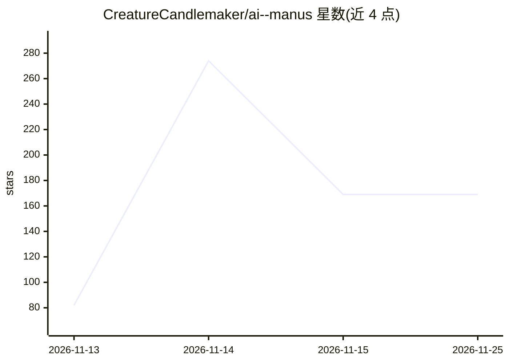

# CreatureCandlemaker/ai--manus

⭐ 169 · Apache-2.0 · 推送 2026-11-15 · [GitHub](https://github.com/CreatureCandlemaker/ai--manus) · 个人维护

**面向个人用户的自主 AI Agent：代跑代码、操控浏览器**

README 宣称的自主 AI Agent 系统，面向家庭、学习与轻量办公场景的非开发者用户：代理可自行编写并执行脚本、操控浏览器完成表单填写与信息收集等跨代码与网页的多步骤任务，可后台常驻并在会话间复用工作流模式。文档给出最低 4 GB 内存/双核 CPU 的兼容性表格与六步上手流程。README 仅含营销式描述与下载指引，未给出任何安装命令、源码结构、模型接入方式或 API 说明，技术细节不可验证。

## 筛选速览

| 维度 | 判定 | 备注 |
|---|---|---|
| AI 角色 | `ai-native` | 本体是模型或模型工具 |
| 许可风险 | `permissive` | Apache-2.0 |
| 部署形态 | `None` |  |
| 模型依赖 | — | README 未给出锁定关系 |
| 硬件要求 | — | 无带数字的原话,不猜 |
| 安装摩擦 | `low` | 无编译、无系统依赖或容器化 |
| 成熟度 | — | 结构信号不足 |

## 能力要点

- 宣称支持自主代码执行与浏览器控制的多步骤任务
- 宣称跨会话记忆工作流模式并在后台运行
- 给出最低 4 GB 内存、双核 CPU 的兼容性要求表

## 适用场景

- 让代理代替手动浏览网页、填表与收集资料
- 自动运行小脚本与整理研究笔记
- 处理日常重复性小任务（文件检查、提醒等）

## 场景标签

`浏览器自动化` `编码 Agent` · 领域:效率与自动化

## 证据(README 行号)

> L10: - **Autonomous Code Execution:** Manus AI agent runs code on its own to complete tasks, so you can focus on decisio
> L18: Manus is an autonomous AI agent designed to run code and control a browser on your behalf. Instead of acting like a
> L41: |**Memory (RAM)**|4 GB|8 GB or more for heavy Manus autonomous tasks|

## 星数曲线

2026-11-13 82 → 2026-11-25 169（+87）

---
*卡片 v1 · prompt 1.4 · 生成 2026-11-17 · 置信度 low · 依据 README sha `0f78ee3a5dd2` · [字段定义](../../DATASET.md)*
