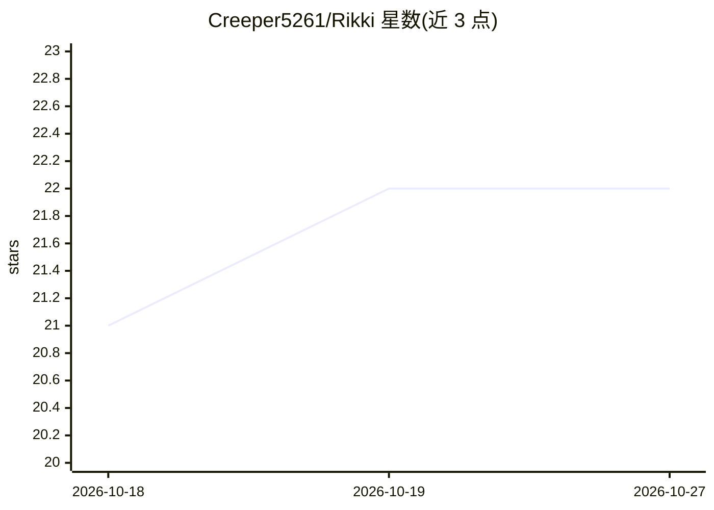

# Creeper5261/Rikki

⭐ 22 · Java · MIT · 推送 2026-07-27 · [GitHub](https://github.com/Creeper5261/Rikki) · 个人维护

**JetBrains IDE 的 AI 编程助手插件：对话代理与行内补全**

面向 JetBrains IDE 的轻量 AI 编程助手插件，无后端服务器、直连 LLM API。功能包括：内嵌侧边栏的 Chat Agent，可读写文件、编辑代码、执行终端命令与 Git 操作，高风险命令需 Approve/Skip 确认；行内 TAB 幽灵文本补全，支持 FIM 模式（DeepSeek/Ollama）与 Chat 格式回退；补全与对话可分别配置不同 provider、模型与 API key。内置 DeepSeek、OpenAI、Gemini、Moonshot/Kimi、Ollama 等预设。要求平台版本 241+ 的 JetBrains IDE 与 LLM API key 或本地 Ollama。

## 筛选速览

| 维度 | 判定 | 备注 |
|---|---|---|
| AI 角色 | `ai-native` | 本体是模型或模型工具 |
| 许可风险 | `permissive` | MIT |
| 部署形态 | `desktop` | 安装包/桌面程序 |
| 模型依赖 | local-ok | 支持本地模型 |
| 硬件要求 | — | 无带数字的原话,不猜 |
| 安装摩擦 | `low` | 无编译、无系统依赖或容器化 |
| 成熟度 | — | 结构信号不足 |

## 能力要点

- Chat Agent 可读写文件、执行终端命令与 Git 操作，高风险命令强制确认
- 行内 TAB 补全支持 FIM 模式（DeepSeek/Ollama）与 Chat 格式回退
- 补全与对话可使用不同的 provider、模型与 API key
- 支持 DeepSeek、OpenAI、Gemini、Moonshot/Kimi、Ollama 及自定义端点

## 适用场景

- 在 JetBrains IDE 内通过对话让 AI 修改代码、执行命令与 Git 操作
- 打字时获得行内补全建议，按 TAB 接受
- 使用本地 Ollama 进行补全与对话，无需 API key

## 场景标签

`AI 助手` `编码 Agent` · 领域:编码与开发

## 证据(README 行号)

> L3: A lightweight AI coding assistant plugin for JetBrains IDEs. Connects directly to LLM APIs — no backend server requi
> L9: An AI panel embedded in the IDE sidebar. The agent can read files, write and edit code, run terminal commands, and p
> L13: Ghost-text suggestions appear as you type; press TAB to accept.

## 星数曲线

2026-10-18 21 → 2026-10-27 22（+1）

---
*卡片 v1 · prompt 1.4 · 生成 2026-10-27 · 置信度 high · 依据 README sha `6d54ac988405` · [字段定义](../../DATASET.md)*
