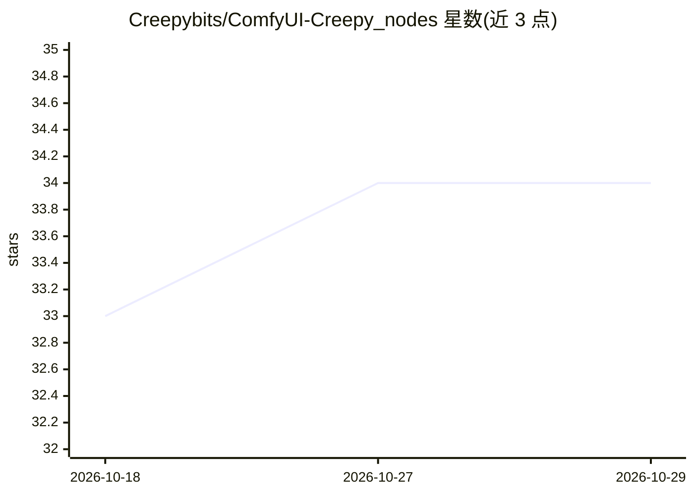

# Creepybits/ComfyUI-Creepy_nodes

⭐ 34 · Python · MIT · 推送 2026-10-22 · [GitHub](https://github.com/Creepybits/ComfyUI-Creepy_nodes) · [官网](https://zanno.se/) · 个人维护

**ComfyUI 自定义节点套件：媒体优化、放大与云盘集成**

面向 ComfyUI 用户的开源自定义节点套件，节点按四大类别组织：利用 Gemini 等 LLM 创建与分析提示词的 AI 代理节点、含开关/延迟/条件逻辑的工作流自动化节点、生成图像视频的排序迁移与 Google Drive/OneDrive 云存储管理节点，以及区域提示、音频合成等专项生成节点。通过 git clone 到 custom_nodes 目录安装并重启 ComfyUI 使用，另提供含 7 个节点、20 余页指南的免费入门工具包。

## 筛选速览

| 维度 | 判定 | 备注 |
|---|---|---|
| AI 角色 | `ai-ecosystem` | LLM/agent 周边工具 |
| 许可风险 | `permissive` | MIT |
| 部署形态 | `None` |  |
| 模型依赖 | — | README 未给出锁定关系 |
| 硬件要求 | — | 无带数字的原话,不猜 |
| 安装摩擦 | `low` | 无编译、无系统依赖或容器化 |
| 成熟度 | — | 结构信号不足 |

## 能力要点

- AI 代理与提示词工程节点（提及 Gemini 等 LLM）
- 开关/延迟/条件逻辑的工作流自动化节点
- 生成媒体文件管理与 Google Drive/OneDrive 云存储集成
- 区域提示、音频合成等专项生成与工具节点

## 适用场景

- 在 ComfyUI 中用 LLM 创建和优化生成提示词
- 搭建带条件分支与延迟的自动化生成工作流
- 将生成的图像视频整理并同步到 Google Drive/OneDrive

## 场景标签

`提示工程` `图像生成` `语音合成` · 领域:Agent 开发

## 证据(README 行号)

> L3: Welcome to the Creepybits custom node suite for ComfyUI! My mission is to create powerful, accessible, and user-frie
> L15: ### 🤖 AI Agents & Prompt Engineering

## 星数曲线

2026-10-18 33 → 2026-10-29 34（+1）

---
*卡片 v1 · prompt 1.4 · 生成 2026-10-25 · 置信度 high · 依据 README sha `2499deb42555` · [字段定义](../../DATASET.md)*
