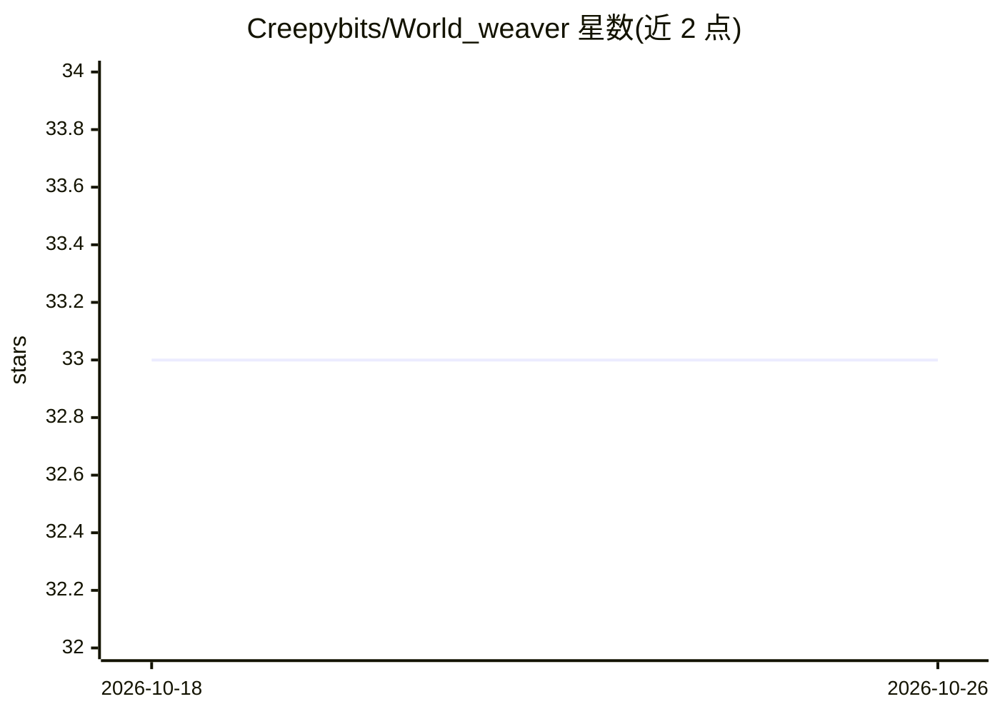

# Creepybits/World_weaver

⭐ 33 · Python · MIT · 推送 2026-10-22 · [GitHub](https://github.com/Creepybits/World_weaver) · [官网](https://zanno.se/creating-consistent-ai-characters-without-loras-or-reactor/) · 个人维护

**ComfyUI 一致性角色生成系统：文本 DNA 跨场景保持角色形象**

由五部分组成的 ComfyUI 角色一致性系统：Prompt Helper 调用 Gemini Vision API 将参考图像转为结构化文本描述（角色 DNA）；Genesis 测试提示词；Character Vault 自定义节点将 DNA 持久保存到 ComfyUI 文件系统供一键调用；World Weaver 主工作流将 DNA 与服装/动作/世界模块化输入组合生成新场景。方法论称不依赖 LoRA、IP-Adapter、ControlNet 等外部文件。支持多 API key 配置与环境变量，需用户自备 Gemini API key。MIT 许可，处于 V1.0 活跃开发期，含视频教程与文章链接。

## 筛选速览

| 维度 | 判定 | 备注 |
|---|---|---|
| AI 角色 | `ai-native` | 本体是模型或模型工具 |
| 许可风险 | `permissive` | MIT |
| 部署形态 | `None` |  |
| 模型依赖 | — | README 未给出锁定关系 |
| 硬件要求 | — | 无带数字的原话,不猜 |
| 安装摩擦 | `low` | 无编译、无系统依赖或容器化 |
| 成熟度 | `idea` | |

## 能力要点

- Gemini Vision API 将图像转为结构化文本角色 DNA
- Character Vault 自定义节点持久保存角色 DNA 至 ComfyUI 文件系统
- 主工作流组合 DNA 与服装/动作/场景模块化输入生成一致角色
- 多 Gemini API key 下拉配置与环境变量 GEMINI_API_KEY 支持

## 适用场景

- 在 ComfyUI 中生成跨姿势、服装、场景保持一致的角色图像
- 将常用角色的文本描述存档并在后续项目中复用
- 用图像反推结构化提示词并先测试再入库

## 场景标签

`图像生成` `提示工程` · 领域:Agent 开发

## 证据(README 行号)

> L17: The **World Weaver System** solves this by establishing **Textual Inheritance**. It is a unique methodology that us
> L27: * **Function:** Uses the Gemini Vision API to analyze any image and convert it into a perfectly structured, ready-t
> L39: * **Function:** The main, complex workflow that combines the character DNA with modular inputs for Clothes, Action,

## 星数曲线

2026-10-18 33 → 2026-10-26 33（+0）

---
*卡片 v1 · prompt 1.4 · 生成 2026-10-25 · 置信度 high · 依据 README sha `979159b01523` · [字段定义](../../DATASET.md)*
