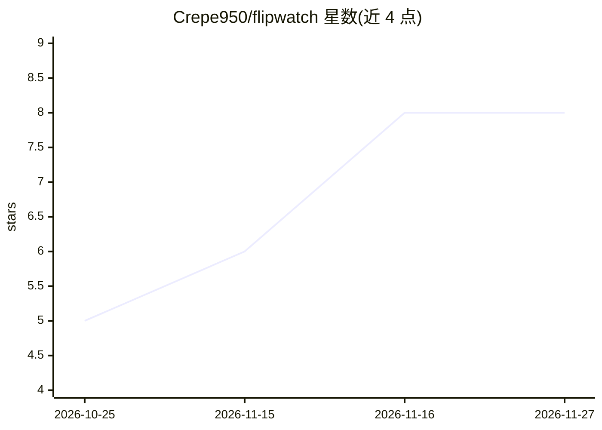

# Crepe950/flipwatch

⭐ 8 · TypeScript · MIT · 推送 2026-10-17 · [GitHub](https://github.com/Crepe950/flipwatch) · 个人维护

**自托管二手市场低价商品监控与 AI 交易分析工具**

FlipWatch 是一个自托管的本地二手交易平台监控工具：按关键词、价格区间与地理位置定期检查 Craigslist、Kijiji、eBay、OfferUp 及可选的 Facebook Marketplace 新上架商品，通过 Discord、Telegram、Slack、ntfy、邮件等渠道推送提醒。AI 部分包括对商品转售估值、建议出价、风险提示与卖方消息草稿，以及自然语言即时搜索排序。首启时选择 AI 引擎（Anthropic/OpenAI API key 或本机 Claude Code/Codex），数据保留在本机。Facebook 抓取方式违反 Meta 服务条款，存在账号被限制风险。

## 筛选速览

| 维度 | 判定 | 备注 |
|---|---|---|
| AI 角色 | `ai-native` | 本体是模型或模型工具 |
| 许可风险 | `permissive` | MIT |
| 部署形态 | `None` |  |
| 模型依赖 | locked-api |  |
| 硬件要求 | — | 无带数字的原话,不猜 |
| 安装摩擦 | `low` | 无编译、无系统依赖或容器化 |
| 成熟度 | — | 结构信号不足 |

## 能力要点

- 多平台保存搜索与分钟级检查，多渠道即时提醒
- AI 转售估值、建议出价与卖方消息草稿
- 自然语言 Deal Hunt 即时搜索与排序
- 翻转追踪看板记录利润与 ROI

## 适用场景

- 监控本地二手市场的低价显卡/电脑等商品
- 用 AI 估价并自动起草砍价消息
- 追踪低买高卖的利润与 ROI

## 场景标签

`网页抓取` · 领域:效率与自动化

## 证据(README 行号)

> L5: FlipWatch watches Craigslist, Kijiji, eBay, OfferUp and (optionally) Facebook Marketplace for the things you
> L10: - **AI deal analysis** — estimated resale value, a fair offer, red flags, questions to ask, and a drafted
> L14: - **Deal Hunt** — type “gaming PCs I can part out under $400” and the AI searches right now and ranks the best.

## 星数曲线

2026-10-25 5 → 2026-11-27 8（+3）

---
*卡片 v1 · prompt 1.4 · 生成 2026-11-20 · 置信度 high · 依据 README sha `331db9844411` · [字段定义](../../DATASET.md)*
