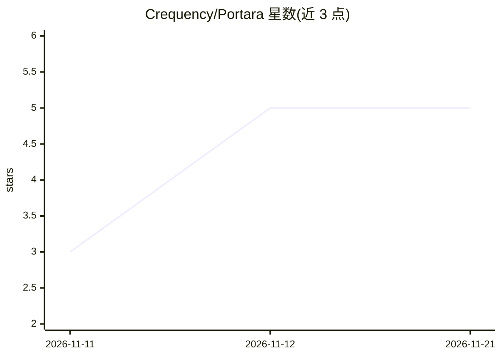

# Crequency/Portara

⭐ 5 · TypeScript · AGPL-3.0 · 推送 2026-11-19 · [GitHub](https://github.com/Crequency/Portara) · 个人维护 · 中文 README

**企业级 AI API 网关：统一入口审计并管理全公司模型调用**

部署在应用与模型供应商之间的聚合网关，暴露单一 OpenAI 兼容端点；密钥、限流、配额、路由与成本核算集中在该层，上游密钥不出现在业务代码中。单进程同时提供 /v1/* 数据面、/api/* 控制面与 Vue 管理控制台。关键机制包括渠道×账户路由与会话亲和、Redis 令牌桶限流、AES-256-GCM 信封加密存储、fail-closed 审计。运行需 Node.js 22.12+、pnpm 11、PostgreSQL 与 Redis；许可证为 AGPL-3.0，修改版以网络服务运行须提供完整源码。

## 筛选速览

| 维度 | 判定 | 备注 |
|---|---|---|
| AI 角色 | `ai-ecosystem` | LLM/agent 周边工具 |
| 许可风险 | `viral` | AGPL-3.0 |
| 部署形态 | `self-host` | docker 或自建部署 |
| 模型依赖 | — | README 未给出锁定关系 |
| 硬件要求 | — | 无带数字的原话,不猜 |
| 安装摩擦 | `low` | 无编译、无系统依赖或容器化 |
| 成熟度 | — | 结构信号不足 |

## 能力要点

- 单一端点同时承载数据面、控制面与 Web 控制台，单容器即完整部署
- OpenAI ⇄ Anthropic 协议翻译，客户端只说 OpenAI 协议
- 渠道×账户路由，支持优先级、权重与会话亲和，额度耗尽目标自动跳过
- AES-256-GCM 信封加密、fail-closed 审计与租户隔离

## 适用场景

- 企业内部统一收口各团队的模型 API 调用并做成本核算
- 对上游密钥做集中加密管理与审计
- 按渠道与账户做多供应商路由和故障转移
- 为运营账号发放受限额度的子密钥

## 场景标签

`模型网关` · 领域:Agent 开发

## 证据(README 行号)

> L10: Portara sits between your applications and the model providers behind them and exposes a single
> L11: OpenAI-compatible endpoint. Credentials, rate limits, quotas, routing and cost accounting all live

## 星数曲线

2026-11-11 3 → 2026-11-21 5（+2）

---
*卡片 v1 · prompt 1.4 · 生成 2026-11-21 · 置信度 high · 依据 README sha `b15524e39162` · [字段定义](../../DATASET.md)*
