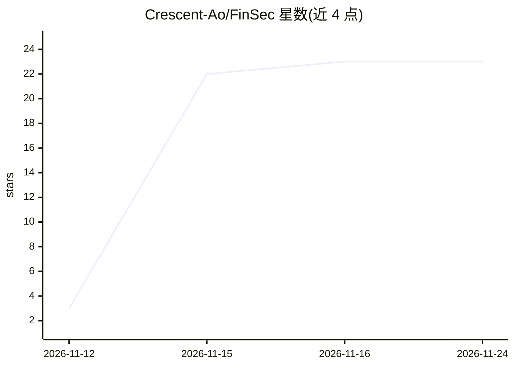

# Crescent-Ao/FinSec

⭐ 23 · Python · Apache-2.0 · 推送 2026-11-13 · [GitHub](https://github.com/Crescent-Ao/FinSec) · [官网](https://modelscope.cn/models/aiops11/Qwen3.5-9B-FinSec) · 个人维护 · 中文 README

**面向金融模型的多阶段后训练与安全/隐私/审计评测框架**

覆盖数据蒸馏构建、五阶段后训练（金融SFT→安全与工具SFT→DPO→安全对抗SFT）、统一评测（FinEval、HarmBench GCG/PAIR、成员推断隐私、Pi-Agent审计规则匹配）到执行型Pi-Agent密码学审计的完整流程。以不超过10B通用指令模型加NF4量化与LoRA适配器为基础，训练用ms-swift；Agent提供11项工具含Python/Bash真实执行（需Linux Bubblewrap沙箱）。模型适配器与基座需运行者自行准备，模型约173MB；训练需GPU（A100/RTX4090为主要验证设备），源码检查与CPU测试仅需Python3.10+。

## 筛选速览

| 维度 | 判定 | 备注 |
|---|---|---|
| AI 角色 | `ai-ecosystem` | LLM/agent 周边工具 |
| 许可风险 | `permissive` | Apache-2.0 |
| 部署形态 | `library` | 以包/库形式分发 |
| 模型依赖 | — | README 未给出锁定关系 |
| 硬件要求 | `cpu-ok` | |
| 安装摩擦 | `low` | 无编译、无系统依赖或容器化 |
| 成熟度 | — | 结构信号不足 |

## 能力要点

- 五阶段后训练流水线：金融SFT→安全与工具SFT→DPO→安全对抗SFT，保留GRPO奖励插件
- 统一评测入口覆盖FinEval、官方HarmBench GCG/PAIR、Loss/Min-k成员推断与Pi-Agent审计
- 执行型Pi-Agent含11项工具，支持源码读写、Python测试与Bash真实执行（Bubblewrap沙箱）
- python3 finsec.py demo 可回放三组历史轨迹，无需GPU或API凭证

## 适用场景

- 复现金融领域模型的安全后训练与评测全流程
- 对金融训练数据做成员推断隐私评估
- 用Pi-Agent对自己的代码执行密码学误用审计

## 场景标签

`模型评测` `金融量化` `微调` · 领域:评测与运维

## 证据(README 行号)

> L18: - **后训练**：金融知识SFT → 安全与工具SFT → DPO → 安全对抗SFT，得到最终FinSec。保留GRPO奖励插件和独立探索实现。
> L19: - **统一评测**：FinEval选项logits；官方HarmBench GCG/PAIR流程及本地NF4适配；Loss、Min-k、参考模型差异成员推断；Pi-Agent规则与行号匹配。
> L20: - **执行型Agent**：基于真正的Pi Agent框架，原生tools schema、assistant工具请求、tool返回进入同一个本地模型上下文。11项工具覆盖源码、规则、工作区读写、Python测试及Bash执行。

## 星数曲线

2026-11-12 3 → 2026-11-24 23（+20）

---
*卡片 v1 · prompt 1.4 · 生成 2026-11-18 · 置信度 mid · 依据 README sha `81f04e4ee9c0` · [字段定义](../../DATASET.md)*
