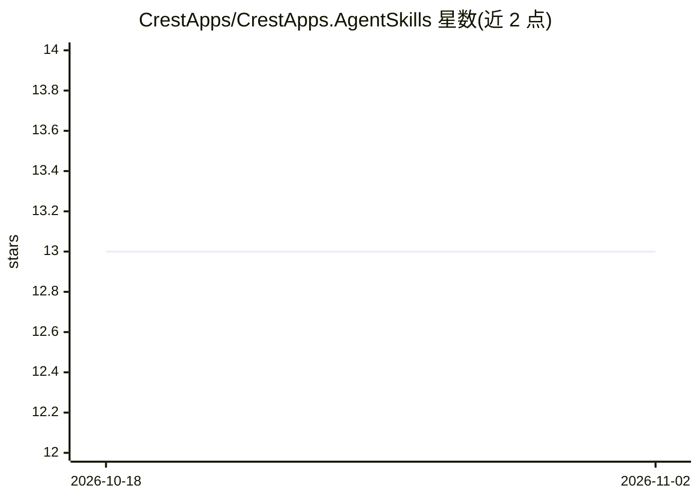

# CrestApps/CrestApps.AgentSkills

⭐ 13 · C# · MIT · 推送 2026-10-21 · [GitHub](https://github.com/CrestApps/CrestApps.AgentSkills) · [官网](https://crestapps.com/) · 个人维护

**.NET 与 Orchard Core 的共享 AI agent 技能与 MCP 工具包**

包含四个项目：技能源目录（按 orchardcore/crestapps-orchardcore/crestapps-core 三类组织）、通用 .NET MCP 技能引擎、开发期复制技能到 .agents/skills 的 Orchard Core 包、运行时捆绑技能的 MCP 包。技能以含 YAML front-matter 的 SKILL.md 目录格式定义，提供 dotnet add package 安装与 AddMcpServer 代码接入；同一技能可通过 GitHub Copilot CLI 插件市场与 Claude Code 插件机制安装。MIT 许可。

## 筛选速览

| 维度 | 判定 | 备注 |
|---|---|---|
| AI 角色 | `ai-ecosystem` | LLM/agent 周边工具 |
| 许可风险 | `permissive` | MIT |
| 部署形态 | `None` |  |
| 模型依赖 | — | README 未给出锁定关系 |
| 硬件要求 | — | 无带数字的原话,不猜 |
| 安装摩擦 | `medium` | 含编译或系统依赖之一 |
| 成熟度 | — | 结构信号不足 |

## 能力要点

- 通用 .NET MCP 技能引擎（CrestApps.AgentSkills.Mcp）
- 技能以 SKILL.md + YAML front-matter 目录格式组织，含本地校验脚本
- 同时发布为 GitHub Copilot CLI 与 Claude Code 插件市场
- 工作流自动重建插件 bundle 并递增版本

## 适用场景

- 在 .NET 应用中托管 MCP 技能服务器
- 为 Orchard Core / CrestApps 项目本地注入 AI 开发技能
- 通过 Copilot CLI 或 Claude Code 安装这些共享技能

## 场景标签

`Agent 框架` · 领域:Agent 开发

## 证据(README 行号)

> L5: Shared **AI agent skills** and MCP tooling for .NET applications, Orchard Core solutions, CrestApps OrchardCore modu
> L12: |`CrestApps.AgentSkills.Mcp`|`src/CrestApps.AgentSkills.Mcp/README.md`|Generic MCP skill engine for any .NET app.|

## 星数曲线

2026-10-18 13 → 2026-11-02 13（+0）

---
*卡片 v1 · prompt 1.4 · 生成 2026-10-31 · 置信度 high · 依据 README sha `820627e02033` · [字段定义](../../DATASET.md)*
