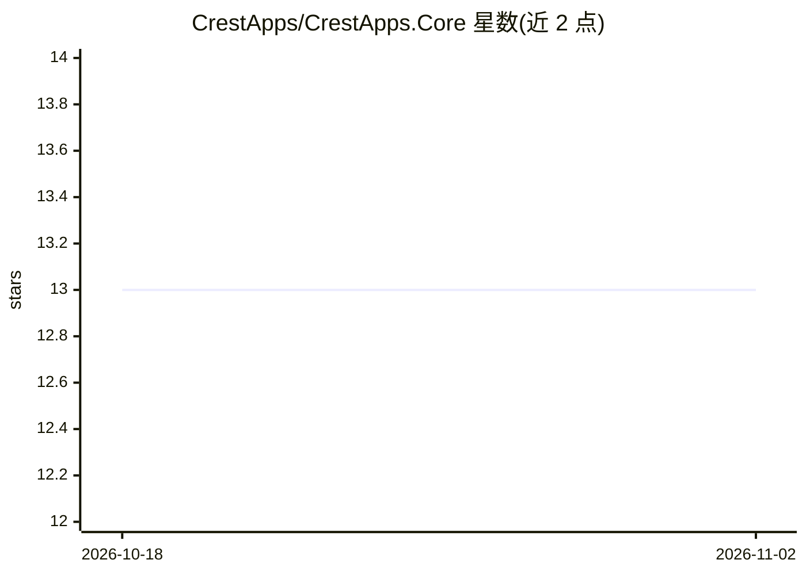

# CrestApps/CrestApps.Core

⭐ 13 · C# · 推送 2026-10-30 · [GitHub](https://github.com/CrestApps/CrestApps.Core) · [官网](https://core.crestapps.com) · 个人维护

**.NET 的组合式 AI 应用与管理框架：聊天、Agent、RAG、MCP、A2A 构建块**

面向 .NET 开发者的 AI 应用框架，将模型/提供商切换、聊天会话管理、文档处理、RAG、MCP 服务端与客户端、A2A agent 协作、工具调用、用量与线索报告等能力封装为可复用的 .NET 服务，避免拼装各家 SDK 示例。提供 AI 连接与部署管理、Agent profile、模板化 prompt、playground 式 Chat Interactions UI，支持 OpenAI 提供商接入及 GitHub Copilot、Claude 编排器集成。通过 NuGet 包安装，附 MVC 示例工程，MIT 许可，由个人开发者利用业余时间维护。

## 筛选速览

| 维度 | 判定 | 备注 |
|---|---|---|
| AI 角色 | `ai-ecosystem` | LLM/agent 周边工具 |
| 许可风险 | `none` | — |
| 部署形态 | `library` | 以包/库形式分发 |
| 模型依赖 | locked-api |  |
| 硬件要求 | — | 无带数字的原话,不猜 |
| 安装摩擦 | `medium` | 含编译或系统依赖之一 |
| 成熟度 | — | 结构信号不足 |

## 能力要点

- 提供商无关的聊天交互与 AI 连接/部署/Agent profile 管理
- RAG 覆盖附加文档、搜索索引与用户记忆，含可配置的预防式 RAG
- MCP server/client 与 A2A agent 间移交能力
- GitHub Copilot 与 Claude 编排器集成

## 适用场景

- 在现有 .NET 应用中添加 AI 聊天、RAG 知识库或文档分析功能
- 构建多 agent 协作团队并通过 A2A 协调
- 搭建带 live-agent 移交和线索报告的客服自动化流程
- 构建由 AI 工具调用驱动自身服务与 API 的工作流自动化

## 场景标签

`Agent 框架` `多智能体` `RAG` · 领域:Agent 开发

## 证据(README 行号)

> L7: **CrestApps.Core is a composable AI management and application framework for .NET.** It gives you the building block
> L27: - **AI management** for connections, deployments, agent profiles, data sources, templates, MCP resources, prompts, 

## 星数曲线

2026-10-18 13 → 2026-11-02 13（+0）

---
*卡片 v1 · prompt 1.4 · 生成 2026-10-31 · 置信度 mid · 依据 README sha `748c4002cac4` · [字段定义](../../DATASET.md)*
