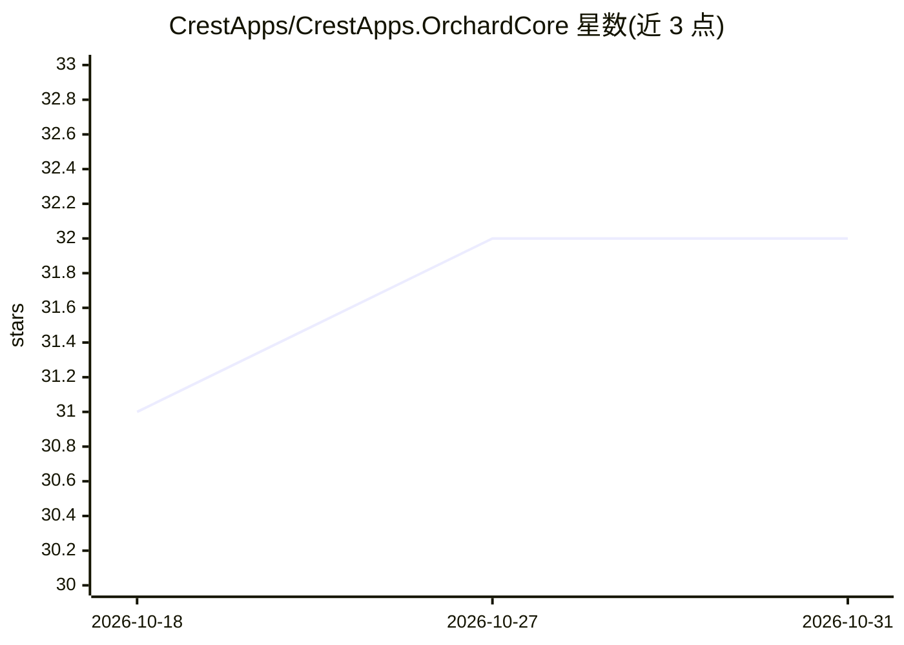

# CrestApps/CrestApps.OrchardCore

⭐ 32 · C# · 推送 2026-10-30 · [GitHub](https://github.com/CrestApps/CrestApps.OrchardCore) · [官网](https://orchardcore.crestapps.com/) · 组织维护

**面向 Orchard Core 的企业级模块套件，含 AI、CRM、呼叫中心等**

CrestApps.OrchardCore 是扩展 Orchard Core CMS 框架的模块与扩展集合，覆盖 AI 编排（聊天、agent、RAG、长期记忆、prompt 管理、MCP/A2A）、全渠道客户互动、CRM、呼叫中心、商务、报表与多租户管理等场景。AI 模块提供可插拔的模型与向量存储 provider（OpenAI、Azure OpenAI、Azure AI Inference、Ollama 等），支持按租户启用各功能。安装以 git clone 源码构建与 NuGet 包为主，部分预览包需配置 Cloudsmith 源，MIT 许可。

## 筛选速览

| 维度 | 判定 | 备注 |
|---|---|---|
| AI 角色 | `ai-enhanced` | 去掉 AI 部分产品仍成立 |
| 许可风险 | `none` | — |
| 部署形态 | `None` |  |
| 模型依赖 | local-ok | 支持本地模型 |
| 硬件要求 | — | 无带数字的原话,不猜 |
| 安装摩擦 | `low` | 无编译、无系统依赖或容器化 |
| 成熟度 | — | 结构信号不足 |

## 能力要点

- AI 聊天/agent/RAG/长期记忆/prompt 管理，支持 MCP 与 A2A 协议
- 可插拔 provider：AI 模型、向量存储、电话运营商、支付网关、云存储
- 多租户、细粒度权限、审计与并发安全数据访问内置于模块设计
- 覆盖 CRM、呼叫中心、商务、报表（OpenXML 导出）等非 AI 业务模块

## 适用场景

- 在 Orchard Core 站点上为租户添加 AI 聊天与 RAG 文档问答能力
- 构建带呼叫中心、CRM 与商务功能的企业级多租户应用
- 通过既有模块组合企业系统，减少自研工作量

## 场景标签

`RAG` `文档问答` `Agent 记忆` `聊天机器人` · 领域:Agent 开发

## 证据(README 行号)

> L7: `CrestApps.OrchardCore` is a suite of modules and extensions that extends the Orchard Core framework with production
> L23: |**Artificial Intelligence**|AI chat and agents, retrieval-augmented generation over documents, data sources, and w

## 星数曲线

2026-10-18 31 → 2026-10-31 32（+1）

---
*卡片 v1 · prompt 1.4 · 生成 2026-10-26 · 置信度 high · 依据 README sha `0501288b5954` · [字段定义](../../DATASET.md)*
