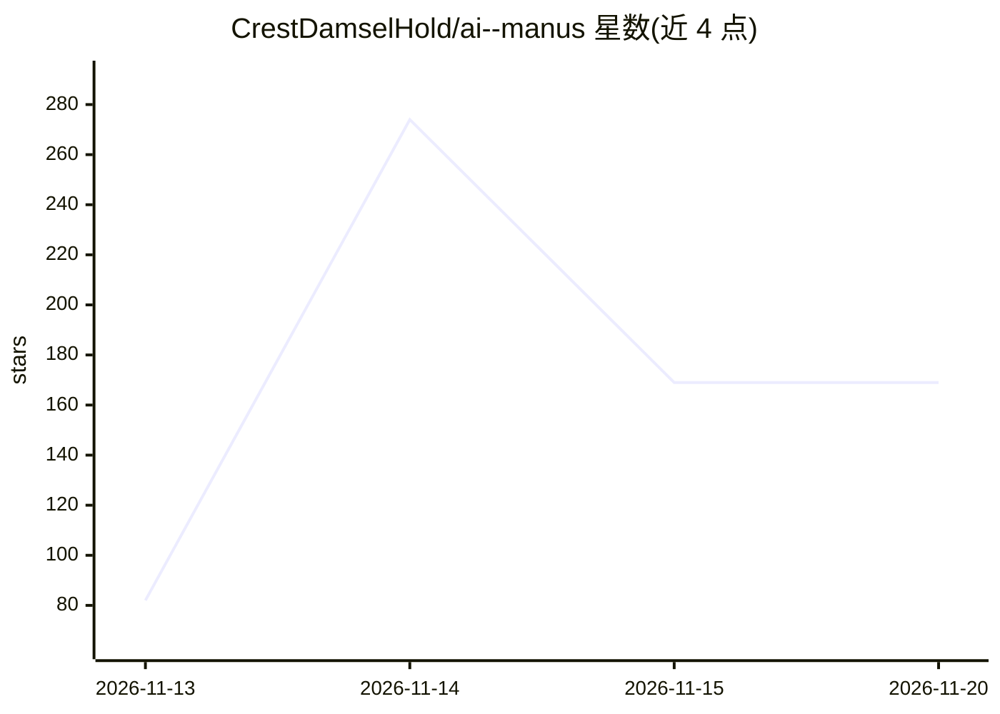

# CrestDamselHold/ai--manus

⭐ 169 · Apache-2.0 · 推送 2026-11-15 · [GitHub](https://github.com/CrestDamselHold/ai--manus) · 个人维护

**自主执行代码与浏览器操作的通用 AI Agent**

Manus 定位为自主 AI Agent，可在用户授权下编写并执行脚本、控制浏览器（导航、填表、采集信息），完成多步骤任务，面向学习、家庭与轻量办公等小规模场景的用户，而非开发者或企业平台用户。README 描述其在后台持续待命、跨会话复用任务模式，并给出硬件兼容表（最低 4GB 内存、双核 CPU）与六步上手流程。描述偏宣传口径，未给出具体模型、架构或安装命令细节，仅提供下载入口与推广码 PROMO2026。

## 筛选速览

| 维度 | 判定 | 备注 |
|---|---|---|
| AI 角色 | `ai-native` | 本体是模型或模型工具 |
| 许可风险 | `permissive` | Apache-2.0 |
| 部署形态 | `None` |  |
| 模型依赖 | — | README 未给出锁定关系 |
| 硬件要求 | — | 无带数字的原话,不猜 |
| 安装摩擦 | `low` | 无编译、无系统依赖或容器化 |
| 成熟度 | — | 结构信号不足 |

## 能力要点

- 自主编写并执行代码完成多步骤任务
- 浏览器控制：导航网页、填表、采集信息
- 脚本与浏览器动作可在同一任务流中衔接
- 面向家庭、学习与轻量办公的小规模场景

## 适用场景

- 让 Agent 代替我跑脚本和查网页，省去重复操作
- 收集资料、整理研究笔记并生成小结
- 远程协助时快速重排诊断步骤与检查系统页面

## 场景标签

`浏览器自动化` `编码 Agent` `AI 助手` · 领域:效率与自动化

## 证据(README 行号)

> L10: - **Autonomous Code Execution:** Manus AI agent runs code on its own to complete tasks, so you can focus on decisio
> L18: Manus is an autonomous AI agent designed to run code and control a browser on your behalf. Instead of acting like a

## 星数曲线

2026-11-13 82 → 2026-11-20 169（+87）

---
*卡片 v1 · prompt 1.4 · 生成 2026-11-17 · 置信度 mid · 依据 README sha `0f78ee3a5dd2` · [字段定义](../../DATASET.md)*
