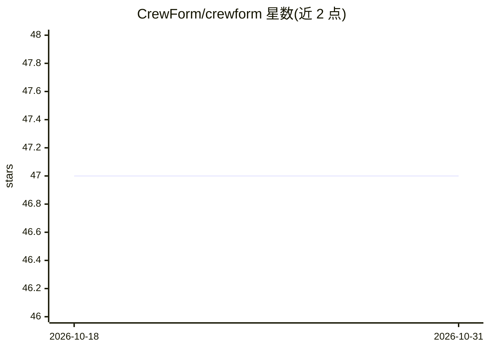

# CrewForm/crewform

⭐ 47 · TypeScript · MIT · 推送 2026-10-18 · [GitHub](https://github.com/CrewForm/crewform) · [官网](https://crewform.vercel.app) · 组织维护

**开发者用的自托管多 Agent 编排运行时，支持 MCP/A2A/AG-UI**

面向开发团队与平台工程团队的多 Agent 编排运行时：以可视化画布与 CLI 创建、编排、观测 Agent，提供 Pipeline、Orchestrator、Collaboration 等团队模式。原生支持 MCP（客户端+服务端）、A2A 双向互操作与 AG-UI 流式输出；可接 16 家 LLM 提供商（含本地 Ollama），支持 BYOK、RAG 知识库（pgvector）、OpenTelemetry/Langfuse 追踪。自托管依赖完整 Supabase 栈、Docker 与 Node.js 20+；另有托管云与 npx CLI（免服务器）两种使用路径。

## 筛选速览

| 维度 | 判定 | 备注 |
|---|---|---|
| AI 角色 | `ai-ecosystem` | LLM/agent 周边工具 |
| 许可风险 | `permissive` | MIT |
| 部署形态 | `self-host` | docker 或自建部署 |
| 模型依赖 | local-ok | 支持本地模型 |
| 硬件要求 | — | 无带数字的原话,不猜 |
| 安装摩擦 | `low` | 无编译、无系统依赖或容器化 |
| 成熟度 | — | 结构信号不足 |

## 能力要点

- MCP 客户端+服务端、A2A 双向、AG-UI SSE 流式的原生协议支持
- 4 种执行模式：单任务、Pipeline、Orchestrator、Collaboration
- 16 家 LLM 提供商接入与 Ollama 本地离线运行（BYOK）
- Docker Compose 自托管、RBAC 多租户、OpenTelemetry + Langfuse 追踪

## 适用场景

- 把多个 LLM Agent 链成可检查的工作流并在自建基础设施上运行
- 通过 MCP/A2A 让 Agent 接入外部工具并与其他框架的 Agent 互操作
- 团队从脚本级 Agent 原型迁移到可部署、可观测的共享运行时

## 场景标签

`多智能体` `Agent 框架` · 领域:Agent 开发

## 证据(README 行号)

> L5: **Open-source workflows for model APIs, Ollama and local coding agents**
> L186: CrewForm is built as agent infrastructure, not just another workflow canvas. It gives you the runtime layer around
> L202: CrewForm supports 4 execution modes — choose the right one for your workflow:

## 星数曲线

2026-10-18 47 → 2026-10-31 47（+0）

---
*卡片 v1 · prompt 1.4 · 生成 2026-10-25 · 置信度 high · 依据 README sha `74d8960e4b01` · [字段定义](../../DATASET.md)*
