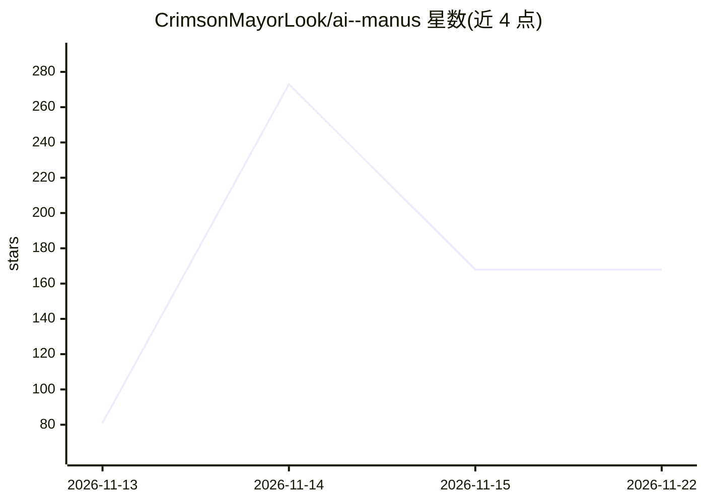

# CrimsonMayorLook/ai--manus

⭐ 168 · Apache-2.0 · 推送 2026-11-15 · [GitHub](https://github.com/CrimsonMayorLook/ai--manus) · 个人维护

**面向日常任务的自主 AI Agent：代写并执行代码、控制浏览器**

README 以功能介绍为主：Manus 定位为自主 AI Agent，可自主执行代码、控制浏览器完成导航、填表、信息收集等多步骤任务，以个人助手形式在后台待命，面向学习、家庭与轻量办公场景的小型任务，强调非开发者也可使用。提供硬件兼容表（4GB 内存起步、推荐 8GB）。限制：README 未给出任何安装命令、依赖说明、模型接入方式或源码运行指引，与仓库描述中的沙箱执行环境无对应展开，事实密度低。

## 筛选速览

| 维度 | 判定 | 备注 |
|---|---|---|
| AI 角色 | `ai-native` | 本体是模型或模型工具 |
| 许可风险 | `permissive` | Apache-2.0 |
| 部署形态 | `None` |  |
| 模型依赖 | — | README 未给出锁定关系 |
| 硬件要求 | — | 无带数字的原话,不猜 |
| 安装摩擦 | `low` | 无编译、无系统依赖或容器化 |
| 成熟度 | — | 结构信号不足 |

## 能力要点

- 自主执行代码与浏览器控制可在同一任务流中衔接
- 多步骤任务可在少量监督下完成，并跨会话复用执行模式
- 给出最低/推荐硬件配置表（双核 CPU、4GB/8GB 内存）
- 面向学习、家庭项目、轻量办公等小规模场景

## 适用场景

- 让 agent 代为完成网页信息收集与表单填写
- 把重复的小型脚本任务委托给后台 agent 执行
- 学习或远程办公场景中自动化多步骤日常杂务

## 场景标签

`AI 助手` `编码 Agent` `浏览器自动化` · 领域:效率与自动化

## 证据(README 行号)

> L10: - **Autonomous Code Execution:** Manus AI agent runs code on its own to complete tasks, so you can focus on decisio
> L18: Manus is an autonomous AI agent designed to run code and control a browser on your behalf. Instead of acting like a

## 星数曲线

2026-11-13 81 → 2026-11-22 168（+87）

---
*卡片 v1 · prompt 1.4 · 生成 2026-11-17 · 置信度 low · 依据 README sha `0f78ee3a5dd2` · [字段定义](../../DATASET.md)*
