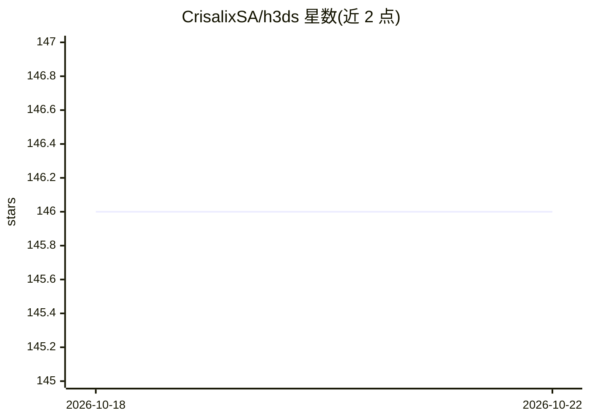

# CrisalixSA/h3ds

⭐ 146 · Python · MIT · 推送 2026-08-06 · [GitHub](https://github.com/CrisalixSA/h3ds) · 组织维护

**三维头部重建数据集 H3DS 的访问与评测工具库，面向科研用户**

提供 H3DS 数据集（H3D-Net ICCV 2021 提出、SIRA++ TPAMI 2025 扩展至 59 个受试者）的 Python 加载与评测工具：以 pip 包安装，凭学术邮箱申请访问令牌后下载，可加载网格、图像、前景掩码与相机参数，支持按视图数配置加载。内置 evaluate_scene 方法计算 Chamfer 距离等指标用于重建结果评测，并给出 IDR/H3D-Net/SIRA++ 在两版数据上的基准表。数据仅限非商业研究用途。

## 筛选速览

| 维度 | 判定 | 备注 |
|---|---|---|
| AI 角色 | `ai-knowledge` | 知识聚合/清单类 |
| 许可风险 | `permissive` | MIT |
| 部署形态 | `library` | 以包/库形式分发 |
| 模型依赖 | — | README 未给出锁定关系 |
| 硬件要求 | — | 无带数字的原话,不猜 |
| 安装摩擦 | `low` | 无编译、无系统依赖或容器化 |
| 成熟度 | — | 结构信号不足 |

## 能力要点

- Python API 加载网格/图像/掩码/相机，支持 1-32 视图配置
- evaluate_scene 单行代码评测 3D 头部重建（Chamfer 等指标）
- 数据集 v2 含 59 个受试者，含数据采集流程说明

## 适用场景

- 3D 头部/人脸重建方法的训练与评测
- 复现 H3D-Net 与 SIRA++ 论文结果并对齐指标
- 少视图神经渲染与数字化身研究的数据获取

## 场景标签

`模型评测` `科研工具` · 领域:评测与运维

## 证据(README 行号)

> L5: This repository contains the code for using the H3DS dataset introduced in H3D-Net: Few-Shot High-Fidelity 3D Head R
> L19: The dataset has grown over a series of releases. Version 1.0 (`config_v1.toml`), introduced in H3D-Net, included 23
> L57: chamfer, _, _, _ = h3ds.evaluate_scene('1b2a8613401e42a8', mesh_pred, landmarks_pred)

## 星数曲线

2026-10-18 146 → 2026-10-22 146（+0）

---
*卡片 v1 · prompt 1.4 · 生成 2026-10-22 · 置信度 high · 依据 README sha `84fc28617690` · [字段定义](../../DATASET.md)*
