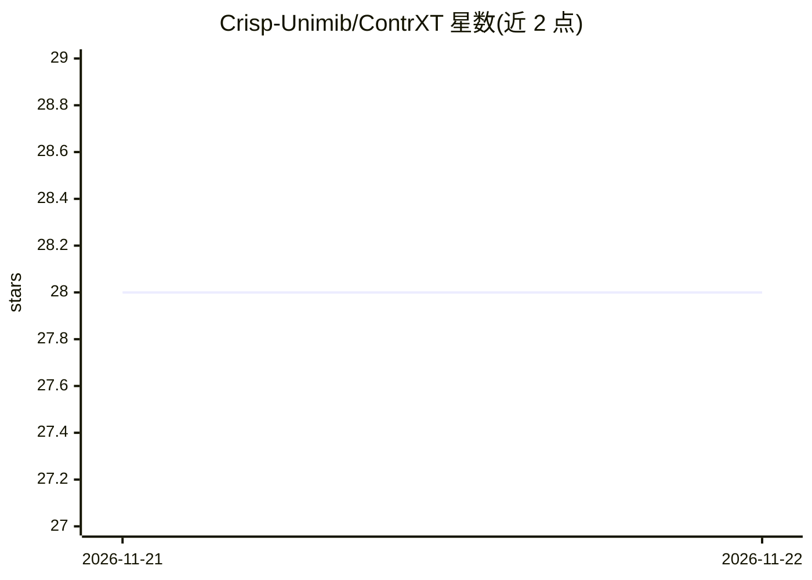

# Crisp-Unimib/ContrXT

⭐ 28 · Python · GPL-3.0 · 推送 2026-11-20 · [GitHub](https://github.com/Crisp-Unimib/ContrXT) · 组织维护

**为文本分类器生成对比性解释的科研工具**

ContrXT 输入两个文本分类器（如模型重训前后的 M1 与 M2）的训练数据与预测标签，通过二元决策图编码两者决策逻辑的变化，输出 Add/Del 类别变化指标（explain.csv）、自然语言解释与规则覆盖统计（paths_add_del.csv）。以 Python 包形式提供，另提供 REST API 服务（需申请免费凭证），并有演示 notebook 与 Google Colab 示例。限制：仅支持文本分类与二值化表格特征，连续特征需先离散化，Python 支持 3.10–3.12。

## 筛选速览

| 维度 | 判定 | 备注 |
|---|---|---|
| AI 角色 | `ai-ecosystem` | LLM/agent 周边工具 |
| 许可风险 | `viral` | GPL-3.0 |
| 部署形态 | `library` | 以包/库形式分发 |
| 模型依赖 | — | README 未给出锁定关系 |
| 硬件要求 | — | 无带数字的原话,不猜 |
| 安装摩擦 | `medium` | 含编译或系统依赖之一 |
| 成熟度 | — | 结构信号不足 |

## 能力要点

- 模型无关的全局时间对比解释（T-contrast），以自然语言输出
- Add/Del 与 add_global/del_global 指标量化各分类标准的变化程度
- 导出 CSV（explain.csv/trace.csv/paths_add_del.csv），Graphviz 渲染替代模型图与 BDD PDF
- 提供 REST API，无需本地安装即可生成解释

## 适用场景

- 比较模型重训前后分类标准的变化
- 对比两个不同文本分类器的行为差异
- 排查重训后哪些类别的决策规则被新增或删除

## 场景标签

`科研工具` · 领域:学习与行业

## 证据(README 行号)

> L26: ContrXT takes as input the training data and predictions of two distinct classifiers M1 and M2. Then, it traces the
> L143: To cite ContrXT please refer to the following paper

## 星数曲线

2026-11-21 28 → 2026-11-22 28（+0）

---
*卡片 v1 · prompt 1.4 · 生成 2026-11-21 · 置信度 high · 依据 README sha `1f95809345a4` · [字段定义](../../DATASET.md)*
