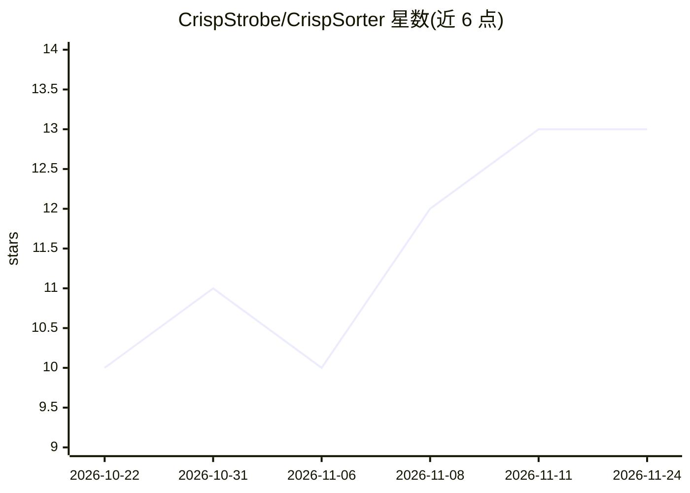

# CrispStrobe/CrispSorter

⭐ 13 · Rust · AGPL-3.0 · 推送 2026-11-23 · [GitHub](https://github.com/CrispStrobe/CrispSorter) · 个人维护

**本地 LLM 整理文档：提取标题作者年份并归档**

桌面/CLI 文档整理工具：读入 PDF、DOCX、电子书等，用本地或可选云 LLM 提取标题、作者、年份，并按 `Sorted/Author/Year/Title` 层级移动文件，同时保留提取文本。支持数字与扫描版 PDF 的多级 OCR 流水线、音视频转录、跨模态搜索、批量去重与会话持久化。所有本地后端无需 API key，云服务商需自行配置密钥并存于系统钥匙串。核心目录引擎 crates/crispcat 以 MIT 许可独立发布，应用本体保留原许可。

## 筛选速览

| 维度 | 判定 | 备注 |
|---|---|---|
| AI 角色 | `ai-native` | 本体是模型或模型工具 |
| 许可风险 | `viral` | AGPL-3.0 |
| 部署形态 | `desktop` | 安装包/桌面程序 |
| 模型依赖 | local-ok | 支持本地模型 |
| 硬件要求 | — | 无带数字的原话,不猜 |
| 安装摩擦 | `high` | 编译与系统依赖俱全 |
| 成熟度 | — | 结构信号不足 |

## 能力要点

- 本地 LLM 提取 Title/Author/Year 并按目录层级归档
- 四级 OCR 引擎（CrispEmbed GGUF / PaddleOCR / ocrs / Tesseract）与 Smart OCR 流水线
- 音视频文件转录并索引为可搜索文档（22 种扩展名）
- 本地后端无需 API key；云密钥存于 OS 钥匙串

## 适用场景

- 把一堆 PDF 和电子书自动整理进作者/年份目录
- 扫描版 PDF 与图片的批量 OCR 与可搜索 PDF 导出
- 对本地文档库做全文与跨模态（图/音频）搜索
- 批量转录音视频文件并建立索引

## 场景标签

`OCR` `文档解析` · 领域:知识与检索

## 证据(README 行号)

> L3: **AI-powered document organiser.** Drop in a folder of PDFs, DOCX files, or ebooks — CrispSorter extracts Title, Aut
> L29: 2. **Analyse** — a local (or cloud) LLM reads each document and suggests Title, Author, Year
> L111: - **Four-tier OCR** (in quality order):

## 星数曲线

2026-10-22 10 → 2026-11-24 13（+3）

---
*卡片 v1 · prompt 1.4 · 生成 2026-11-18 · 置信度 mid · 依据 README sha `deb0156d019c` · [字段定义](../../DATASET.md)*
