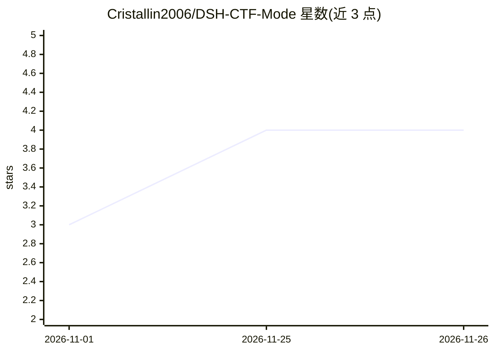

# Cristallin2006/DSH-CTF-Mode

⭐ 4 · Python · MIT · 推送 2026-10-28 · [GitHub](https://github.com/Cristallin2006/DSH-CTF-Mode) · [官网](https://github.com/Cristallin2006/DSH-CTF-Skill/blob/main/docs/QUICKSTART.md) · 个人维护 · 中文 README

**为 DeepSeek Harness 提供全栈 CTF 解题技能与子代理编排**

面向 DeepSeek Harness（DSH）宿主的 CTF 与安全分析技能库，覆盖 Web、逆向、密码学、Pwn、Android 和流量取证方向。提供三类机制：单兵与编排两种 CTF 预设（编排模式下启用持续型 Solver 子会话，支持进度监督与同 work 续做）、按授权召回的结构化记忆与方法卡、证据复核流程。完整模式为实验性，需 Linux/WSL、Node.js 24+ 与已安装的 DSH；另有仅技能安装方式。README 说明本地 TSecBench 跑分为用户提供的非官方记录，真实解题效果需另行评估。

## 筛选速览

| 维度 | 判定 | 备注 |
|---|---|---|
| AI 角色 | `ai-ecosystem` | LLM/agent 周边工具 |
| 许可风险 | `permissive` | MIT |
| 部署形态 | `None` |  |
| 模型依赖 | — | README 未给出锁定关系 |
| 硬件要求 | — | 无带数字的原话,不猜 |
| 安装摩擦 | `low` | 无编译、无系统依赖或容器化 |
| 成熟度 | — | 结构信号不足 |

## 能力要点

- 持续型 Solver 子会话编排：独立执行、监督指导、保留自身历史
- 结构化记忆：证据来源、条件、冲突与修订，方法卡脱敏复用
- 覆盖 Web/逆向/密码学/Pwn/Android/流量取证的技能与参考卡
- 提供 Python 3.10+ 可运行的合成字节恢复本地示例

## 适用场景

- 让 DSH 宿主的 agent 处理单道 CTF 题并交付复现脚本与证据
- 用编排模式并行处理多个独立 CTF 目标
- 在新材料到达后对既有 work 续做并复核旧结论

## 场景标签

`网络安全` · 领域:学习与行业

## 证据(README 行号)

> L9: 面向 DeepSeek Harness（DSH） 的 CTF 与安全分析技能库。覆盖 Web、逆向、密码学、Pwn、Android 和流量取证；可按任务启用持续型子代理、结构化记忆与证据复核。
> L17: **模型选择分析路线，运行层维护可靠状态，skill 提供专业方法。** 简单任务直接做；值得分工的任务再启用编排。
> L68: 完整模式需要 Linux/WSL、Node.js 24+ 和已安装的 DSH；还需初始化状态、配置自己的模型并注册宿主插件。已有安装升级前先备份、暂停任务并确认收尾，详见入门指南。专业工具按方向准备，见 TOOLSET。

## 星数曲线

2026-11-01 3 → 2026-11-26 4（+1）

---
*卡片 v1 · prompt 1.4 · 生成 2026-11-22 · 置信度 high · 依据 README sha `c1a90f259b56` · [字段定义](../../DATASET.md)*
