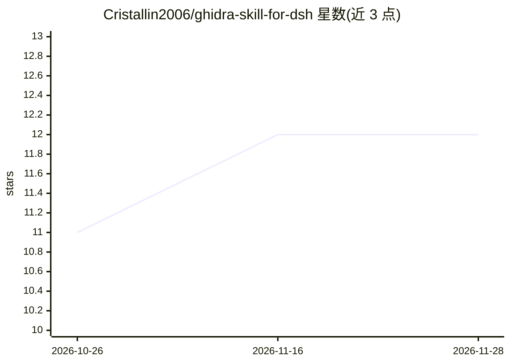

# Cristallin2006/ghidra-skill-for-dsh

⭐ 12 · Python · MIT · 推送 2026-10-11 · [GitHub](https://github.com/Cristallin2006/ghidra-skill-for-dsh) · 个人维护 · 中文 README

**为 dsh 提供基于 Ghidra headless 的逆向工程 agent skill 家族**

面向 dsh（DeepSeek Harness）的逆向工程 skill 集合：以 Ghidra 12.x headless 常驻 daemon 为底座（vendored ghidra-rpc + 补丁，Python 3.11+），按 1 底座 + 8 场景组织——分诊/脱壳/静态/漏洞审计/动态/pwn/流量/APK。关键机制包括三道脚本闸门强制台账落账、六种台账对象、函数级 Oracle 与模型对拍、可选 dsh-hooks 熔断层拦截探索失控。安装方式为目录拷贝至 ~/.dsh/skills/ 并建 venv editable 安装引擎，需自备 Ghidra 12.x 与 JDK 21+。

## 筛选速览

| 维度 | 判定 | 备注 |
|---|---|---|
| AI 角色 | `ai-ecosystem` | LLM/agent 周边工具 |
| 许可风险 | `permissive` | MIT |
| 部署形态 | `desktop` | 安装包/桌面程序 |
| 模型依赖 | — | README 未给出锁定关系 |
| 硬件要求 | — | 无带数字的原话,不猜 |
| 安装摩擦 | `low` | 无编译、无系统依赖或容器化 |
| 成熟度 | — | 结构信号不足 |

## 能力要点

- Ghidra 12.x headless 常驻 daemon，亚秒级命令响应
- 1 底座 + 8 场景的 skill 结构，方法论与执行代码分离
- 14 条铁律以脚本闸门强制执行（违规 exit 2）
- 可选 dsh-hooks 准则强制层，含探索熔断与卡点自述熔断

## 适用场景

- CTF 逆向题的自动化求解与 agent 流程约束
- 恶意样本分诊与脱壳后的静态/动态分析
- pcap 流量取证与 Android APK 逆向
- 二进制利用（pwn）题的漏洞利用流程

## 场景标签

`网络安全` · 领域:学习与行业

## 证据(README 行号)

> L13: 面向 dsh（DeepSeek Harness）的逆向工程 agent skill 家族：Ghidra 12.x headless 常驻 daemon（~0.2s/命令，无 Jython/GUI/MCP 依赖）+ 八场景方法论。覆
> L55: 边界规则：执行代码在 core，场景 skill 只有方法论；知识存 `references/` 可 grep 的纯数据文件，路由靠触发点指针，不建"知识库 skill"。
> L93: catalog 只注入 skill 的 description，SKILL.md 正文和铁律不在上下文里——"AI 不遵守 skill 准则"多源于此。`dsh-hooks/` 用 dsh 内置的 hooks-claude-cod

## 星数曲线

2026-10-26 11 → 2026-11-28 12（+1）

---
*卡片 v1 · prompt 1.4 · 生成 2026-11-18 · 置信度 high · 依据 README sha `2a2784abbe00` · [字段定义](../../DATASET.md)*
