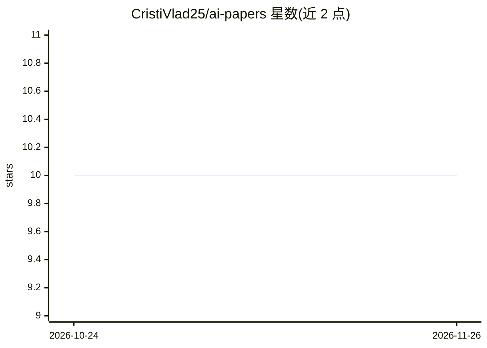

# CristiVlad25/ai-papers

⭐ 10 · MIT · 推送 2026-08-29 · [GitHub](https://github.com/CristiVlad25/ai-papers) · 个人维护

**AI 与 LLM 发展历程的论文学习路线清单**

按时间线组织的学习课程表：从 1943 年 McCulloch-Pitts 神经元模型、感知机、反向传播、LSTM，经统计 NLP 与深度学习突破，到 Transformer、GPT 系列、BERT、缩放定律与 RLHF，共收录 46 个里程碑条目；每条给出论文名、作者与一句内容说明，部分条目附讲解视频链接。维护者以 (I am currently here) 标注自己的学习进度（截至 ULMFiT 条目）。为纯文档仓库，无安装或运行步骤。

## 筛选速览

| 维度 | 判定 | 备注 |
|---|---|---|
| AI 角色 | `ai-knowledge` | 知识聚合/清单类 |
| 许可风险 | `permissive` | MIT |
| 部署形态 | `None` |  |
| 模型依赖 | — | README 未给出锁定关系 |
| 硬件要求 | — | 无带数字的原话,不猜 |
| 安装摩擦 | `low` | 无编译、无系统依赖或容器化 |
| 成熟度 | — | 结构信号不足 |

## 能力要点

- 46 个里程碑论文按 5 个历史时期组织
- 每条包含论文名、作者与内容摘要
- 附带个人学习进度标记机制
- 部分条目附论文讲解视频链接

## 适用场景

- 按时间线系统阅读 AI/LLM 领域的奠基论文
- 为自学深度学习与 NLP 制定阅读计划
- 查找某个里程碑工作的原始论文与作者信息

## 场景标签

`教程课程` `精选清单` · 领域:学习与行业

## 证据(README 行号)

> L3: This curriculum traces the development of artificial intelligence and large language models (LLMs) from the early da
> L9: 1. **1943 – McCulloch and Pitts Model**

## 星数曲线

2026-10-24 10 → 2026-11-26 10（+0）

---
*卡片 v1 · prompt 1.4 · 生成 2026-11-20 · 置信度 high · 依据 README sha `3d8723d19eaf` · [字段定义](../../DATASET.md)*
