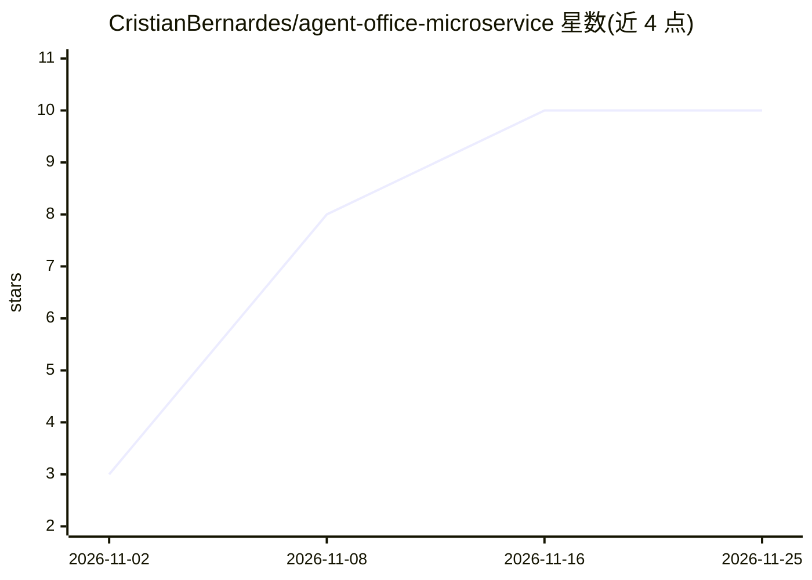

# CristianBernardes/agent-office-microservice

⭐ 10 · Python · NOASSERTION · 推送 2026-11-13 · [GitHub](https://github.com/CristianBernardes/agent-office-microservice) · [官网](https://www.youtube.com/watch?v=eq40fTZwJrc) · 个人维护

**多智能体模拟的软件团队办公服务：规划、辩论并交付任务**

用 AI 智能体模拟一个 IT 办公室，27 种角色（PO、Scrum Master、Tech Lead、QA 等）各有独立 system prompt、人格与工具权限，经 MQTT 事件流实时协作，产出 ADR、backlog、测试计划等 Markdown 文件。用户作为产品所有者批准招聘、解雇与决策；权限校验集中实现、不委托给 LLM。技术栈为 FastAPI + Svelte 5 + Kafka + Redis + Postgres(pgvector) + Prometheus/Grafana，docker-compose 部署，Ollama 在宿主机运行，支持 pt/en 双语。采用 AGPL-3.0 + 商业许可的双许可模式。

## 筛选速览

| 维度 | 判定 | 备注 |
|---|---|---|
| AI 角色 | `ai-native` | 本体是模型或模型工具 |
| 许可风险 | `none` | NOASSERTION |
| 部署形态 | `self-host` | docker 或自建部署 |
| 模型依赖 | local-ok | 支持本地模型 |
| 硬件要求 | — | 无带数字的原话,不猜 |
| 安装摩擦 | `low` | 无编译、无系统依赖或容器化 |
| 成熟度 | — | 结构信号不足 |

## 能力要点

- 27 种角色智能体，按关键词路由任务，权限校验集中在代码而非 LLM
- MQTT 事件驱动协作，Go 网关桥接 MQTT→Kafka 并带 Redis 去重与 DLQ
- Kanban 面板、招聘/解雇审批与 Grafana 可观测性面板
- AGPL-3.0 + 商业许可双许可，含明码标价的商业授权与服务

## 适用场景

- 给团队一个产品目标，让智能体完成规划、调研、辩论并产出文档
- 以监督者身份审批智能体团队的招聘、解雇与决策
- 自动化产品/技术团队的例行规划、研究与文档工作

## 场景标签

`多智能体` · 领域:Agent 开发

## 证据(README 行号)

> L11: > Um escritório de TI simulado por agentes de IA — cada um com um papel, personalidade e modelo de
> L12: > linguagem próprios, colaborando em tempo real via MQTT para pesquisar, debater, decidir e
> L193: Todo o fluxo é orientado a eventos MQTT com um envelope de mensagem padrão (`event_id`, `timestamp`,

## 星数曲线

2026-11-02 3 → 2026-11-25 10（+7）

---
*卡片 v1 · prompt 1.4 · 生成 2026-11-20 · 置信度 mid · 依据 README sha `9003459a6d7c` · [字段定义](../../DATASET.md)*
