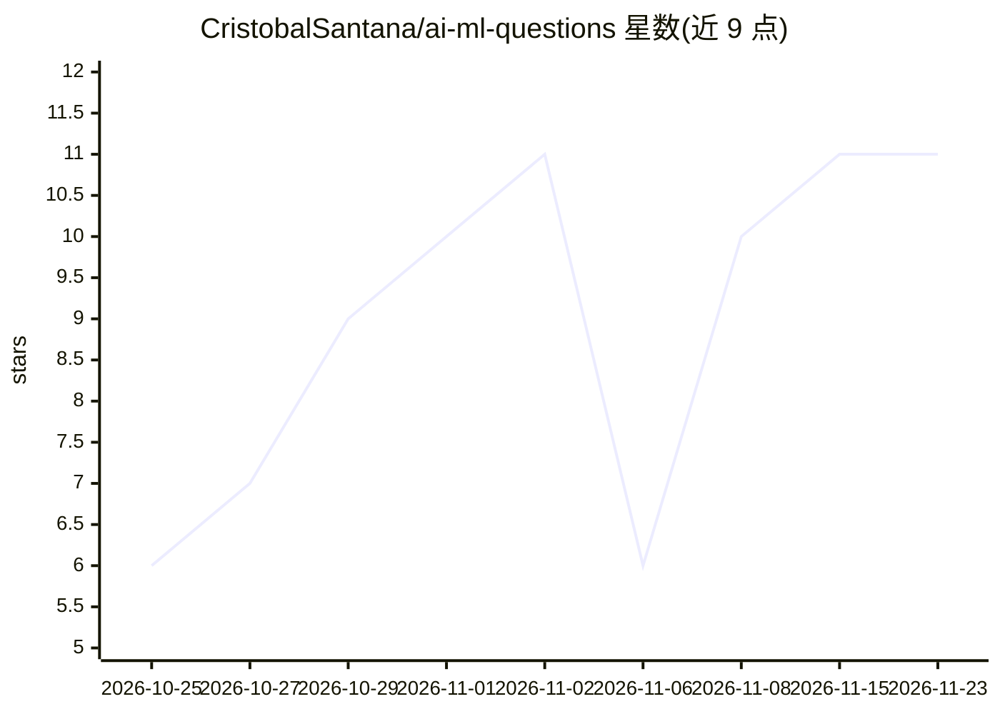

# CristobalSantana/ai-ml-questions

⭐ 11 · Python · MIT · 推送 2026-11-12 · [GitHub](https://github.com/CristobalSantana/ai-ml-questions) · [官网](https://ai-ml-questions.strangemachines.workers.dev/) · 个人维护

**面向学习者的 AI/ML 选择题题库：每题带解析与来源引用**

免费的 AI 与机器学习选择题测验站，含 103 道英文/西语双语题目，覆盖 8 个主题、三级 Bloom 认知层级。每道题的每个选项都解释对错原因并引用来源；题目遵循 Haladyna 编写规则并经校验器检查，由模型核验事实后再经人工审核。匿名记录真实作答（无 Cookie），统计实际难度与干扰项效果。题目为带 schema 的 JSON 文件，采用 CC BY-SA 4.0 许可，站点为 Alpha 版，加载后可离线使用。

## 筛选速览

| 维度 | 判定 | 备注 |
|---|---|---|
| AI 角色 | `ai-knowledge` | 知识聚合/清单类 |
| 许可风险 | `permissive` | MIT |
| 部署形态 | `library` | 以包/库形式分发 |
| 模型依赖 | — | README 未给出锁定关系 |
| 硬件要求 | — | 无带数字的原话,不猜 |
| 安装摩擦 | `low` | 无编译、无系统依赖或容器化 |
| 成熟度 | `idea` | |

## 能力要点

- 103 道英/西双语题，8 主题、三级难度与 Bloom 层级标注
- 每个选项附对错解释，每题引用来源
- 题目为带 schema 的 JSON 文件，可复用于课程或自建应用
- 匿名作答统计真实难度与干扰项，无需账号、支持离线

## 适用场景

- 系统学习或复习机器学习与 LLM 相关概念
- 课程或闪卡复用开放题库（JSON + CC BY-SA 4.0）
- 本地运行校验器与站点构建脚本自建测验站

## 场景标签

`教程课程` · 领域:学习与行业

## 证据(README 行号)

> L5: Free multiple-choice questions for learning artificial intelligence and machine learning, from the basics to researc
> L14: - **Open questions.** They are JSON files with a schema, under CC BY-SA 4.0, so you can reuse them in a course, in 
> L30: |Landmark papers|From the perceptron (1958) to FlashAttention (2022)|

## 星数曲线

2026-10-25 6 → 2026-11-23 11（+5）

---
*卡片 v1 · prompt 1.4 · 生成 2026-11-19 · 置信度 mid · 依据 README sha `86e1ca66cb0d` · [字段定义](../../DATASET.md)*
