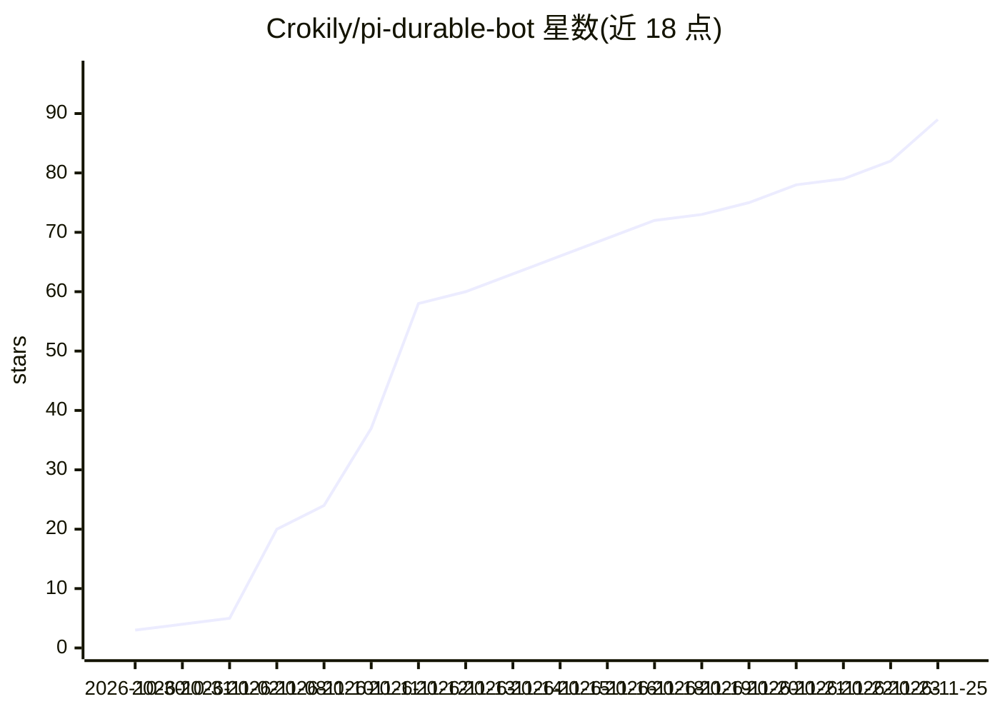

# Crokily/pi-durable-bot

⭐ 89 · TypeScript · MIT · 推送 2026-11-24 · [GitHub](https://github.com/Crokily/pi-durable-bot) · [官网](https://pots.sh) · 个人维护

**自托管的开源 AI 同事机器人：接入聊天渠道自主干活**

用 Node 24+ 运行、MIT 许可的自托管 AI agent 机器人，可接入 Slack、Discord、Telegram、Teams（预览）等渠道。它读取所加入渠道的全部消息，自行判断是否需要行动，在自有计算机上通过 shell、文件、浏览器与屏幕写代码并执行任务，也支持子 agent（children）后台分工、本地 SQLite 长期记忆与定时唤醒。模型不绑定：可用订阅登录、40+ 提供商、OpenAI 兼容端点或本地模型（Ollama/LM Studio/llama.cpp）。Linux 上基于 systemd 管理命令作用域与崩溃恢复。

## 筛选速览

| 维度 | 判定 | 备注 |
|---|---|---|
| AI 角色 | `ai-native` | 本体是模型或模型工具 |
| 许可风险 | `permissive` | MIT |
| 部署形态 | `library` | 以包/库形式分发 |
| 模型依赖 | local-ok | 支持本地模型 |
| 硬件要求 | — | 无带数字的原话,不猜 |
| 安装摩擦 | `low` | 无编译、无系统依赖或容器化 |
| 成熟度 | — | 结构信号不足 |

## 能力要点

- 读取渠道全部消息并自行决定是否行动（含 judge 分类器机制）
- code mode：自写脚本，用 read/write/edit/bash/screen 等通用工具完成任务
- 子 agent（children）后台执行长任务，崩溃后可恢复且消息只送达一次
- 模型无关：订阅登录、40+ 提供商、OpenAI 兼容端点或 Ollama 本地模型

## 适用场景

- 在团队 Slack/Discord 里部署一个自主处理事务的 AI 同事
- 让机器人监控网页、跑研究、做报表并定时汇报
- 数据不出本机地运行本地模型的 AI 协作者

## 场景标签

`AI 助手` · 领域:对话与助手

## 证据(README 行号)

> L5: **The open-source Grok Bot alternative: an AI coworker that acts on its own.**
> L44: **Any model.** Log in once with a subscription you already pay for, use an API key from any of the 40+ providers pi
> L59: |**How it works**|Calls the tools someone wired in|Writes and runs its own code on its own computer|

## 星数曲线

2026-10-30 3 → 2026-11-25 89（+86）

---
*卡片 v1 · prompt 1.4 · 生成 2026-11-18 · 置信度 high · 依据 README sha `e89651547d12` · [字段定义](../../DATASET.md)*
