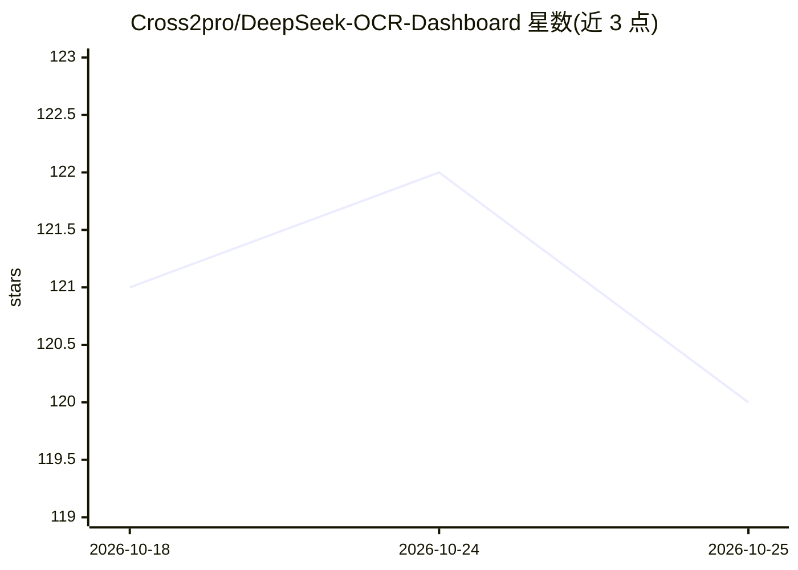

# Cross2pro/DeepSeek-OCR-Dashboard

⭐ 120 · Python · MIT · 推送 2026-04-06 · [GitHub](https://github.com/Cross2pro/DeepSeek-OCR-Dashboard) · 个人维护 · 中文 README

**DeepSeek-OCR 模型的本地 Web UI：上传 PDF/图像并可视化识别结果**

基于 FastAPI + Vite/Vue 的本地 Web 界面，封装 DeepSeek-OCR 模型用于快速测试：支持 PDF 与图像上传（PDF 自动分页）、上传与推理过程进度显示、边界框叠加的版面/标注可视化、标注详情查看与历史结果管理，并有实时日志与工作流步骤跟踪。测试环境为 Python 3.10 + PyTorch 2.6.0+cu118 + RTX 3090，通过 conda 建环境后用 start.sh 同时启动后端（8000）与前端（5173），可用环境变量覆盖模型权重路径、端口与上传大小限制等。

## 筛选速览

| 维度 | 判定 | 备注 |
|---|---|---|
| AI 角色 | `ai-native` | 本体是模型或模型工具 |
| 许可风险 | `permissive` | MIT |
| 部署形态 | `None` |  |
| 模型依赖 | locked-api |  |
| 硬件要求 | — | 无带数字的原话,不猜 |
| 安装摩擦 | `medium` | 含编译或系统依赖之一 |
| 成熟度 | — | 结构信号不足 |

## 能力要点

- PDF/图像上传，PDF 自动分页
- 边界框叠加的版面与标注可视化
- 进度跟踪、历史结果管理与实时日志
- 环境变量配置模型路径/端口/CORS/上传限制

## 适用场景

- 本地快速体验 DeepSeek-OCR 模型的识别效果
- 上传含数学公式或表格的文档查看识别与版面结果
- 调试 OCR 工作流并通过日志跟踪步骤

## 场景标签

`OCR` `文档解析` · 领域:知识与检索

## 证据(README 行号)

> L5: FastAPI + Vite/Vue wrapper around the DeepSeek-OCR model for quick local testing. 🎯
> L15: - 📄 PDF & 🖼️ image upload, with automatic PDF page splitting.

## 星数曲线

2026-10-18 121 → 2026-10-25 120（-1）

---
*卡片 v1 · prompt 1.4 · 生成 2026-10-23 · 置信度 high · 依据 README sha `a4f1d47977c8` · [字段定义](../../DATASET.md)*
