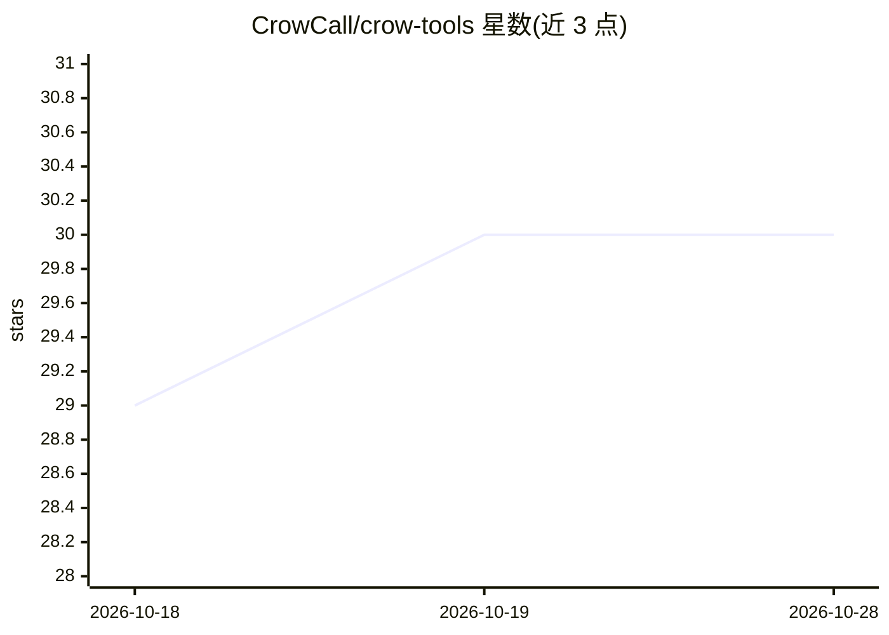

# CrowCall/crow-tools

⭐ 30 · Python · MIT · 推送 2026-04-02 · [GitHub](https://github.com/CrowCall/crow-tools) · [官网](http://crowtools.org) · 个人维护

**鸦科发声分析工具包：下载、降噪、检测、分类鸦叫并标注**

面向鸟类爱好者与研究者的美国鸦（Corvus brachyrhynchos）叫声分析工具集：从 Macaulay Library、Xeno-Canto 等公开数据源下载 13+ GB 音频，经降噪（基于 Earth Species Project 的 biodenoising）、检测、AVES 模型生成 768 维嵌入后自动分类（警戒、数量、年龄、rattle、soft song、音质），并提供 Vue/Node.js 网页界面做人工标注与转录，另有重叠叫声分离模块。构建于 Ubuntu 24.04 与 Python 3.8+，需 Git LFS 与 FFmpeg。

## 筛选速览

| 维度 | 判定 | 备注 |
|---|---|---|
| AI 角色 | `ai-native` | 本体是模型或模型工具 |
| 许可风险 | `permissive` | MIT |
| 部署形态 | `library` | 以包/库形式分发 |
| 模型依赖 | — | README 未给出锁定关系 |
| 硬件要求 | — | 无带数字的原话,不猜 |
| 安装摩擦 | `medium` | 含编译或系统依赖之一 |
| 成熟度 | — | 结构信号不足 |

## 能力要点

- 下载器从多个公开馆藏获取 13+ GB 鸦叫音频并保存来源署名
- AVES 嵌入模型将每次鸦叫转为 768 维向量
- 自定义分类器自动标注警戒/数量/年龄/rattle 等类别
- 网页标注与转录界面（Vue v3 + Node.js，含 3D 嵌入可视化）

## 适用场景

- 批量下载并清洗公开鸦叫数据集
- 自动检测并分类音频中的鸦叫片段
- 人工审核与标注训练数据、构建鸦叫转录集

## 场景标签

 · 领域:动物行为/音频分析

## 证据(README 行号)

> L83: The classifier module analyzes crow call embeddings and categorizes them (i.e. auto labels) into various types such
> L121: The embedder module transforms each crow call into a 768-dimensional vector using the AVES embedding model. This

## 星数曲线

2026-10-18 29 → 2026-10-28 30（+1）

---
*卡片 v1 · prompt 1.4 · 生成 2026-10-26 · 置信度 mid · 依据 README sha `3649ba2f62e3` · [字段定义](../../DATASET.md)*
