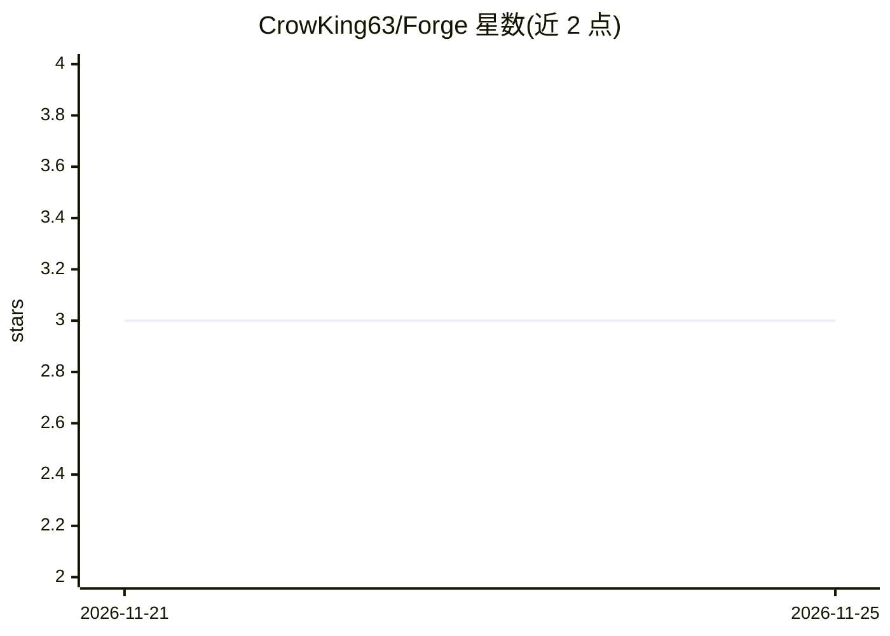

# CrowKing63/Forge

⭐ 3 · C# · MIT · 推送 2026-11-10 · [GitHub](https://github.com/CrowKing63/Forge) · [官网](https://crowking63.github.io/Forge/) · 个人维护

**给 Windows 用户的本地离线热键翻译工具**

面向 Windows 的本地英文翻译工具：在任何应用中选中文本后按全局热键 Ctrl+E，由本地 GGUF 模型（CPU 或 GPU 运行）完成翻译并替换选区；部分应用（记事本、Word、Edge、Chrome）支持原位替换，其余回退到剪贴板。模型默认从 Hugging Face 一次性下载（Gemma 4 E2B QAT，约 2.6 GB），也可放入任意 .gguf 文件。提供安装包与便携版 zip，自包含构建无需安装 .NET，无遥测、除模型下载外无网络访问。

## 筛选速览

| 维度 | 判定 | 备注 |
|---|---|---|
| AI 角色 | `ai-native` | 本体是模型或模型工具 |
| 许可风险 | `permissive` | MIT |
| 部署形态 | `desktop` | 安装包/桌面程序 |
| 模型依赖 | local-ok | 支持本地模型 |
| 硬件要求 | — | 无带数字的原话,不猜 |
| 安装摩擦 | `low` | 无编译、无系统依赖或容器化 |
| 成熟度 | — | 结构信号不足 |

## 能力要点

- 全局热键选中文本即译，原位替换或剪贴板回退
- 本地 GGUF 模型推理，支持任意 .gguf 模型文件
- 空闲自动卸载模型（立即/1 分钟/5 分钟/从不）
- 安装包与便携版双发行形式，自包含无需 .NET

## 适用场景

- 在任意 Windows 应用里离线翻译选中文本
- 不希望文本外发云端的隐私场景
- 便携方式在 U 盘携带使用翻译工具

## 场景标签

 · 领域:翻译/桌面工具

## 证据(README 行号)

> L3: A local translator into English for Windows — one hotkey, nothing else. Select text in any app, press **Ctrl+E**, an
> L10: - The text is translated by a local GGUF model running on your machine (CPU or GPU)

## 星数曲线

2026-11-21 3 → 2026-11-25 3（+0）

---
*卡片 v1 · prompt 1.4 · 生成 2026-11-22 · 置信度 high · 依据 README sha `dfa41b1dc847` · [字段定义](../../DATASET.md)*
