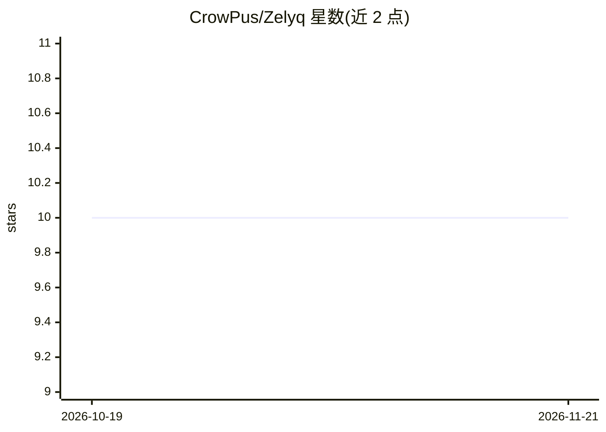

# CrowPus/Zelyq

⭐ 10 · TypeScript · AGPL-3.0 · 推送 2026-11-18 · [GitHub](https://github.com/CrowPus/Zelyq) · [官网](https://zelyq.com) · 组织维护

**自托管 AI 应用构建平台：描述需求，Agent 在真实工作区生成并部署应用**

Zelyq 是一个自托管开发者平台，将应用构建、密钥管理、CI 流水线和部署整合为一体。用户描述应用需求后，Agent 在用户拥有的真实文件中规划、写代码、运行命令并启动预览，完成后执行 typecheck/build 与崩溃检查进行验证。支持三种技术栈（React+Vite、React+FastAPI、Expo React Native），提供密钥加密保险库（AES-256-GCM）、YAML 流水线（可在自有 Linux/macOS/Windows 机器上经 SSH 运行）、按环境的部署与健康检查自动回滚。要求 Node >= 20.12 与 pnpm >= 9，自带模型密钥，无遥测。

## 筛选速览

| 维度 | 判定 | 备注 |
|---|---|---|
| AI 角色 | `ai-native` | 本体是模型或模型工具 |
| 许可风险 | `viral` | AGPL-3.0 |
| 部署形态 | `self-host` | docker 或自建部署 |
| 模型依赖 | local-ok | 支持本地模型 |
| 硬件要求 | — | 无带数字的原话,不猜 |
| 安装摩擦 | `low` | 无编译、无系统依赖或容器化 |
| 成熟度 | — | 结构信号不足 |

## 能力要点

- Agent 生成应用后运行项目自身 typecheck/build 并检查预览崩溃，未通过则回传修复
- Vault 密钥库：AES-256-GCM 加密、版本历史、审计追踪、vault:// 引用填充
- 流水线可在自有 Linux/macOS/Windows 机器经 SSH 运行，部署失败自动回滚
- 支持自定义 OpenAI 兼容端点（Ollama/vLLM/LM Studio），custom 模式数据不出内网

## 适用场景

- 用自然语言描述并让 Agent 生成全栈应用，实时查看并编辑结果
- 团队集中管理 API 密钥，避免密钥散落各处
- 在自有机器上跑测试构建流水线并按环境部署应用
- 从现有 GitHub 仓库或 Figma 设计稿启动应用开发

## 场景标签

`编码 Agent` · 领域:编码与开发

## 证据(README 行号)

> L34: |**Build**|**Apps**|Describe an app; an agent plans it, builds it in real files you own, and verifies it before cal
> L48: Describe what you want. The agent reads, plans, writes files, runs commands and starts a live preview —
> L9: **Self-hosted. Bring your own model. No telemetry.**

## 星数曲线

2026-10-19 10 → 2026-11-21 10（+0）

---
*卡片 v1 · prompt 1.4 · 生成 2026-11-20 · 置信度 mid · 依据 README sha `b14beeead4fa` · [字段定义](../../DATASET.md)*
