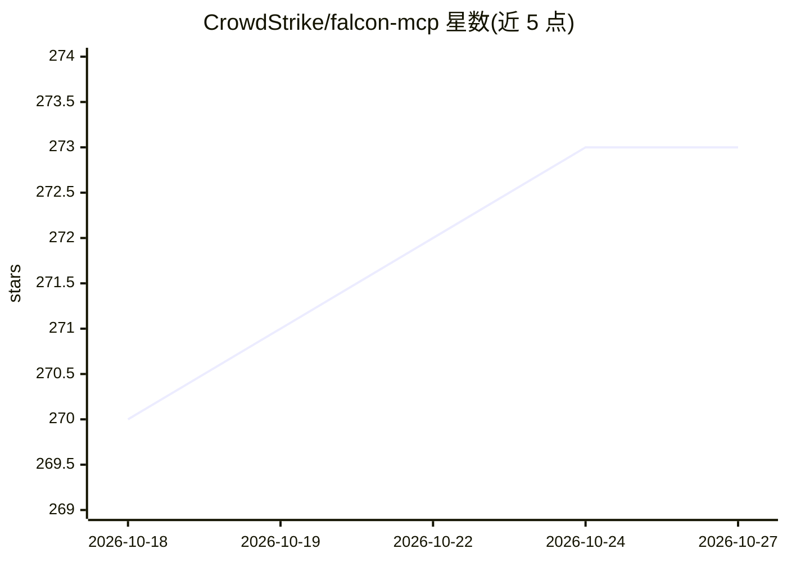

# CrowdStrike/falcon-mcp

⭐ 273 · Python · MIT · 推送 2026-10-24 · [GitHub](https://github.com/CrowdStrike/falcon-mcp) · [官网](https://developer.crowdstrike.com/falcon-mcp/overview/) · 组织维护

**连接 AI agent 与 CrowdStrike Falcon 平台的 MCP 服务器**

由 CrowdStrike 维护的 Model Context Protocol (MCP) 服务器，将 AI agent 接入 Falcon 平台的 28 个安全模块，覆盖检测分析、威胁情报、主机管理、NG-SIEM 查询、漏洞管理等安全运营能力。提供动态模式（三个元工具按需加载 schema 以压缩上下文）、模块/工具级多层过滤（--read-only/--tools/--exclude-tools）与 Docker 部署。需配置 FALCON_CLIENT_ID/SECRET 凭据运行；处于 1.0 前阶段，接口可能在次版本间变动。

## 筛选速览

| 维度 | 判定 | 备注 |
|---|---|---|
| AI 角色 | `ai-ecosystem` | LLM/agent 周边工具 |
| 许可风险 | `permissive` | MIT |
| 部署形态 | `self-host` | docker 或自建部署 |
| 模型依赖 | — | README 未给出锁定关系 |
| 硬件要求 | — | 无带数字的原话,不猜 |
| 安装摩擦 | `low` | 无编译、无系统依赖或容器化 |
| 成熟度 | `idea` | |

## 能力要点

- 28 个模块覆盖检测、威胁情报、主机管理、NG-SIEM 等 Falcon 能力
- 动态模式以 list/search/execute 三个元工具按需加载工具 schema
- 工具级多层过滤：--read-only/--tools/--exclude-tools 固定顺序组合
- 提供 pip/uv 安装与 Docker 容器部署

## 适用场景

- 让 AI agent 查询和分析 Falcon 检测与威胁情报
- 通过 agent 执行 NG-SIEM CQL 查询与主机管理操作
- 以只读模式构建安全调查专用 MCP 服务器
- 部署到 Amazon Bedrock AgentCore 或 Google Cloud 运行

## 场景标签

`网络安全` · 领域:学习与行业

## 证据(README 行号)

> L13: **falcon-mcp** is a Model Context Protocol (MCP) server that connects AI agents with the CrowdStrike Falcon platfor
> L16: > **Pre-1.0 release**: falcon-mcp is under active development ahead of 1.0. Tool names, parameters, and response sh

## 星数曲线

2026-10-18 270 → 2026-10-27 273（+3）

---
*卡片 v1 · prompt 1.4 · 生成 2026-10-22 · 置信度 high · 依据 README sha `5eb63e46f6f6` · [字段定义](../../DATASET.md)*
