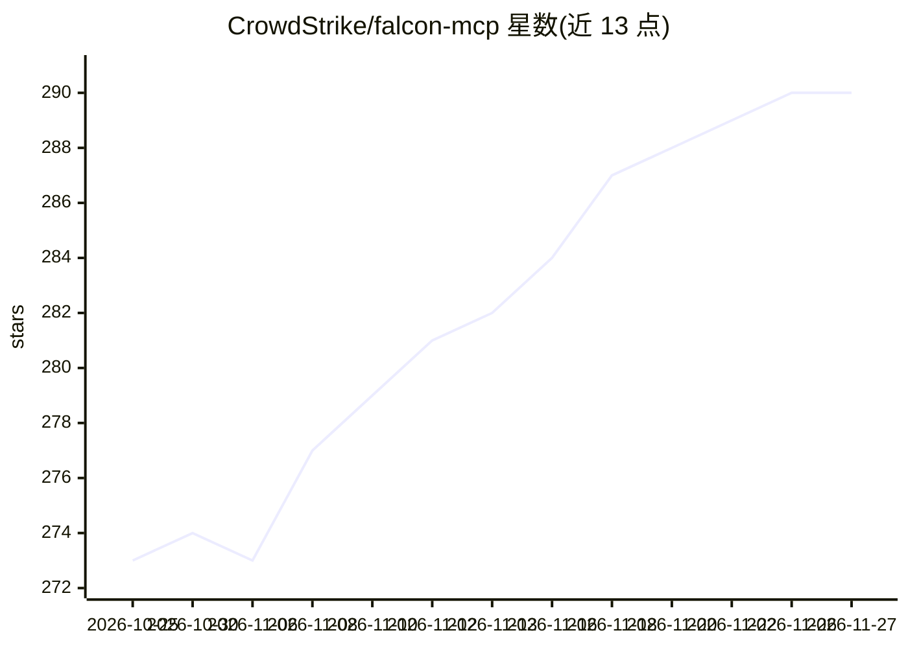

# CrowdStrike/falcon-mcp

⭐ 290 · Python · MIT · 推送 2026-11-17 · [GitHub](https://github.com/CrowdStrike/falcon-mcp) · [官网](https://developer.crowdstrike.com/falcon-mcp/overview/) · 组织维护

**将 AI agent 接入 CrowdStrike Falcon 平台做安全分析的 MCP 服务器**

falcon-mcp 是一个 Model Context Protocol 服务器，向 AI agent 提供对 CrowdStrike Falcon 平台的程序化访问，覆盖检测分析、威胁情报、主机管理、漏洞、防火墙、SIEM 等约 30 个模块的工具面。通过环境变量配置 Falcon API 凭据后以 uv/pip 安装或 Docker 容器运行，支持编辑器集成。提供动态模式按需加载工具 schema 以控制上下文占用，并可用 --read-only、--tools、--exclude-tools 组合收敛可执行工具范围。注意：项目已进入维护模式，新功能仅在 CrowdStrike 托管的 CrowdStrike MCP 中开发，本仓库后续仅发布安全与依赖修复，并将在公告后归档。

## 筛选速览

| 维度 | 判定 | 备注 |
|---|---|---|
| AI 角色 | `ai-ecosystem` | LLM/agent 周边工具 |
| 许可风险 | `permissive` | MIT |
| 部署形态 | `self-host` | docker 或自建部署 |
| 模型依赖 | — | README 未给出锁定关系 |
| 硬件要求 | — | 无带数字的原话,不猜 |
| 安装摩擦 | `low` | 无编译、无系统依赖或容器化 |
| 成熟度 | — | 结构信号不足 |

## 能力要点

- 约 30 个模块的 MCP 工具面：检测、威胁情报、主机、漏洞、防火墙、NG-SIEM 等
- 动态模式仅暴露 3 个发现/执行工具，按需加载参数 schema
- --read-only/--tools/--exclude-tools 可组合的工具面收敛机制
- 提供 PyPI 包、uvx 与 Docker 容器部署方式

## 适用场景

- 在支持 MCP 的客户端中让 agent 自动分析 Falcon 检测结果与开展威胁狩猎
- 以只读模式为安全运营团队搭建调查类 agent 工具面
- 将 Falcon 主机、漏洞、情报查询能力接入自动化安全工作流

## 场景标签

`网络安全` · 领域:学习与行业

## 证据(README 行号)

> L13: **falcon-mcp** is a Model Context Protocol (MCP) server that connects AI agents with the CrowdStrike Falcon platfor
> L16: > **falcon-mcp is now in maintenance mode.** Development continues in CrowdStrike MCP, CrowdStrike's hosted MCP ser
> L168: Running many modules at once inflates the context window every AI client must hold. Dynamic mode

## 星数曲线

2026-10-25 273 → 2026-11-27 290（+17）

---
*卡片 v1 · prompt 1.4 · 生成 2026-11-25 · 置信度 high · 依据 README sha `e30a6963b8b6` · [字段定义](../../DATASET.md)*
