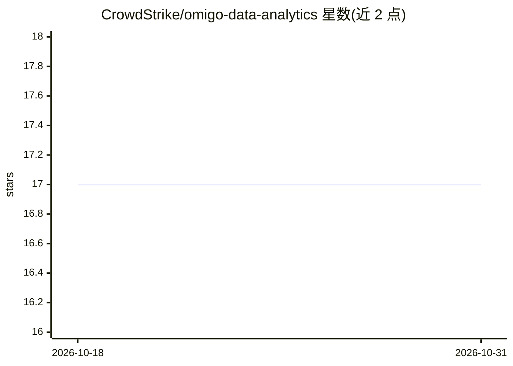

# CrowdStrike/omigo-data-analytics

⭐ 17 · Python · MIT · 推送 2026-10-29 · [GitHub](https://github.com/CrowdStrike/omigo-data-analytics) · 组织维护

**Python 端到端数据分析库：读取、变换、分析与可视化**

函数式风格 API 的 Python 数据分析库，覆盖从本地/S3/URL 读取多种数据格式、join、聚合、采样、时序处理、schema 演化到基于 matplotlib/seaborn 的可视化。分 core、extensions、hydra 三个包：core 依赖极少，extensions 含可视化与 Kafka/ETL/Web 服务读取等扩展，hydra 为未启用的分布式实验代码。面向数据探索、宽表（数百上千列）与复杂业务逻辑场景，可导出 pandas DataFrame。作者声明项目处于研究阶段，不用于生产。

## 筛选速览

| 维度 | 判定 | 备注 |
|---|---|---|
| AI 角色 | `ai-ecosystem` | LLM/agent 周边工具 |
| 许可风险 | `permissive` | MIT |
| 部署形态 | `self-host` | docker 或自建部署 |
| 模型依赖 | — | README 未给出锁定关系 |
| 硬件要求 | — | 无带数字的原话,不猜 |
| 安装摩擦 | `low` | 无编译、无系统依赖或容器化 |
| 成熟度 | `idea` | |

## 能力要点

- 函数式 API 覆盖读取→变换→分析→可视化全流程
- 支持本地/S3/Web URL 读写多种数据格式
- extensions 包含 Kafka 读取、Web 服务调用、ETL、多线程等扩展
- 可与 pandas DataFrame 互导

## 适用场景

- 在数据探索阶段快速尝试变换与分析
- 处理数百上千列的宽数据集
- 从 Kafka 或分区存储中读取时序数据做分析

## 场景标签

 · 领域:数据科学/数据分析

## 证据(README 行号)

> L4:  * Python library to do end to end data analytics from reading to transformation, analysis and visualization.
> L7:  * Advanced APIs for doing join, aggregation, sampling, and processing time series data.

## 星数曲线

2026-10-18 17 → 2026-10-31 17（+0）

---
*卡片 v1 · prompt 1.4 · 生成 2026-10-30 · 置信度 mid · 依据 README sha `bdeddd903132` · [字段定义](../../DATASET.md)*
