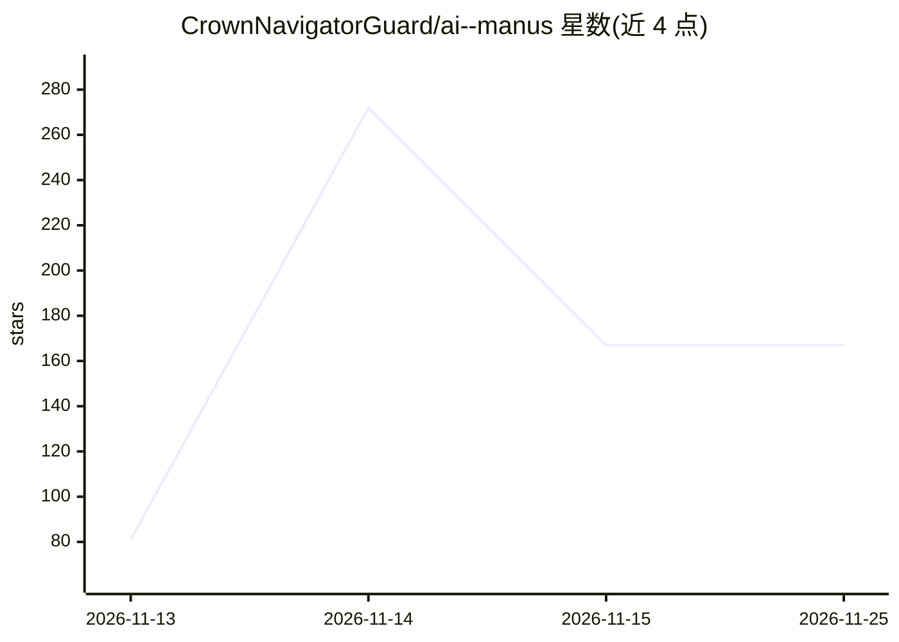

# CrownNavigatorGuard/ai--manus

⭐ 167 · Apache-2.0 · 推送 2026-11-15 · [GitHub](https://github.com/CrownNavigatorGuard/ai--manus) · 个人维护

**面向个人用户的自主 AI Agent：代为执行代码与浏览器操作**

自述为通用自主 AI Agent，核心能力是在用户授权下自主编写并执行脚本、控制浏览器（导航网页、填表、采集信息），并可执行多步任务，面向学习、家庭与轻量办公场景的学生、远程工作者等非开发者用户。README 声明其定位为小型助手而非企业平台，并给出硬件兼容表（最低 4 GB 内存、双核 CPU）。但 README 未提供任何安装命令、模型接入方式或代码仓库结构说明，仅有功能描述与启动步骤文字，技术实现细节不可验证。

## 筛选速览

| 维度 | 判定 | 备注 |
|---|---|---|
| AI 角色 | `ai-native` | 本体是模型或模型工具 |
| 许可风险 | `permissive` | Apache-2.0 |
| 部署形态 | `None` |  |
| 模型依赖 | — | README 未给出锁定关系 |
| 硬件要求 | — | 无带数字的原话,不猜 |
| 安装摩擦 | `low` | 无编译、无系统依赖或容器化 |
| 成熟度 | — | 结构信号不足 |

## 能力要点

- 自主执行代码与脚本（Autonomous Code Execution）
- 浏览器控制：导航、填表、信息采集
- 跨会话保持任务模式，代码与浏览器动作可在同一流程内衔接

## 适用场景

- 让学生整理研究笔记、跑快速计算
- 代为完成网页信息采集与重复性表单填写
- 开发调试时快速运行小实验脚本

## 场景标签

`浏览器自动化` `编码 Agent` `AI 助手` · 领域:效率与自动化

## 证据(README 行号)

> L10: - **Autonomous Code Execution:** Manus AI agent runs code on its own to complete tasks, so you can focus on decisio
> L18: Manus is an autonomous AI agent designed to run code and control a browser on your behalf. Instead of acting like a

## 星数曲线

2026-11-13 81 → 2026-11-25 167（+86）

---
*卡片 v1 · prompt 1.4 · 生成 2026-11-17 · 置信度 low · 依据 README sha `0f78ee3a5dd2` · [字段定义](../../DATASET.md)*
