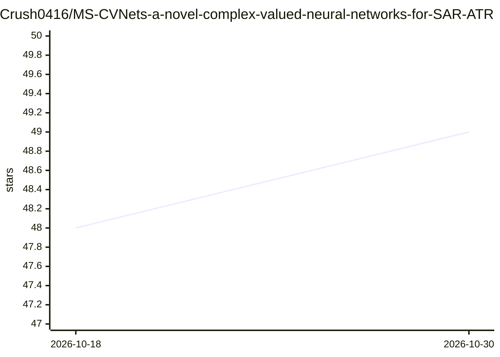

# Crush0416/MS-CVNets-a-novel-complex-valued-neural-networks-for-SAR-ATR

⭐ 49 · Python · 推送 2026-09-05 · [GitHub](https://github.com/Crush0416/MS-CVNets-a-novel-complex-valued-neural-networks-for-SAR-ATR) · 个人维护

**SAR 自动目标识别研究代码：多流复值神经网络方法**

IEEE TGRS 论文 'SAR Automatic Target Recognition Method Based on Multi-Stream Complex-Valued Networks' 的官方代码实现，基于 PyTorch 构建多流复值网络，用于 MSTAR 数据集上的 SAR 目标识别。仓库同时整理发布了 Complex-MSTAR 数据集（64x64 与 128x128，含 SOC/EOC 场景），提供 Train.py 与 Test.py 脚本。要求 Python 3.7、PyTorch 1.6、CUDA 10.1。代码基于 cplxmodule、complexPyTorch、deep_complex_networks 等复值网络库搭建。

## 筛选速览

| 维度 | 判定 | 备注 |
|---|---|---|
| AI 角色 | `ai-native` | 本体是模型或模型工具 |
| 许可风险 | `none` | — |
| 部署形态 | `None` |  |
| 模型依赖 | — | README 未给出锁定关系 |
| 硬件要求 | — | 无带数字的原话,不猜 |
| 安装摩擦 | `medium` | 含编译或系统依赖之一 |
| 成熟度 | — | 结构信号不足 |

## 能力要点

- 多流复值神经网络实现 SAR ATR
- 整理 Complex-MSTAR 数据集（SOC/EOC，64 与 128 尺寸）
- 提供训练与测试脚本（Train.py / Test.py）

## 适用场景

- 复值网络方法在 SAR 目标识别研究中的复现
- 使用整理后的 Complex-MSTAR 数据集开展实验
- 作为雷达遥感目标识别论文的引用实现

## 场景标签

`目标检测` · 领域:感知与多模态

## 证据(README 行号)

> L3: The code in this toolbox implements the "SAR Automatic Target Recognition Method based on Muliti-Stream Complex-Valu
> L27: ---python 3.7
> L28: ---pytorch 1.6

## 星数曲线

2026-10-18 48 → 2026-10-30 49（+1）

---
*卡片 v1 · prompt 1.4 · 生成 2026-10-25 · 置信度 high · 依据 README sha `5c01aeb14604` · [字段定义](../../DATASET.md)*
