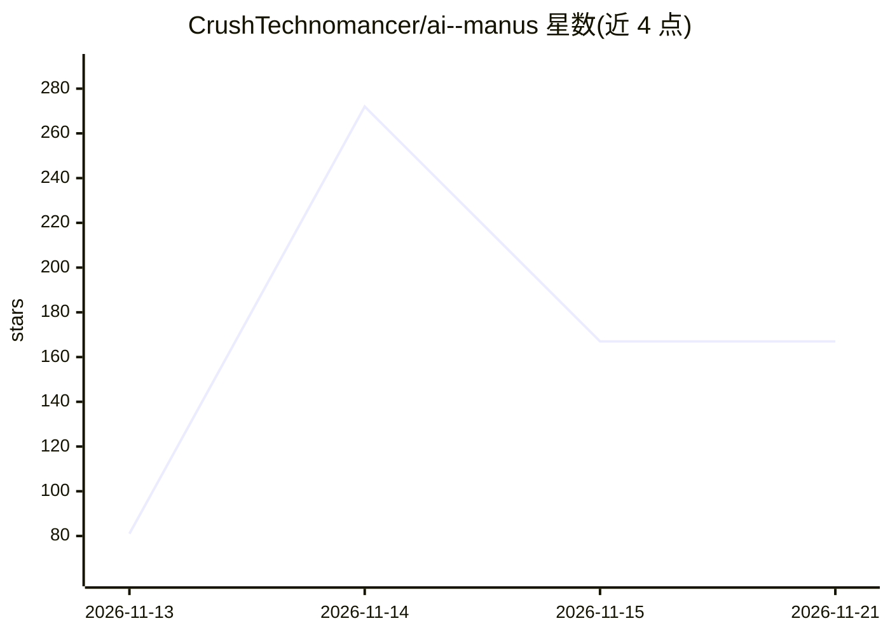

# CrushTechnomancer/ai--manus

⭐ 167 · Apache-2.0 · 推送 2026-11-15 · [GitHub](https://github.com/CrushTechnomancer/ai--manus) · 个人维护

**面向个人用户的自主 AI Agent：自动执行代码与浏览器操作**

自述为通用型自主 AI 代理系统，在沙盒环境中运行各类工具：可自行编写并执行脚本、控制浏览器完成导航、填表与信息收集，处理学习、家庭与轻办公中的多步骤任务，无需用户编程基础。README 说明其面向小规模场景而非企业平台，给出兼容性表（最低 4GB 内存、双核 CPU）与六步上手流程，但未提供具体安装命令、代码仓库结构或模型接入细节，功能描述多为宣传性表述。

## 筛选速览

| 维度 | 判定 | 备注 |
|---|---|---|
| AI 角色 | `ai-native` | 本体是模型或模型工具 |
| 许可风险 | `permissive` | Apache-2.0 |
| 部署形态 | `None` |  |
| 模型依赖 | — | README 未给出锁定关系 |
| 硬件要求 | — | 无带数字的原话,不猜 |
| 安装摩擦 | `low` | 无编译、无系统依赖或容器化 |
| 成熟度 | — | 结构信号不足 |

## 能力要点

- 自主编写并执行代码以完成任务
- 浏览器控制：导航、填表、跨页信息收集
- 代码与浏览器操作在同一流程内衔接
- 沙盒环境中运行工具与操作

## 适用场景

- 让学生组织研究笔记、运行小型脚本
- 让 agent 代为浏览网页、收集多页信息并汇总
- 把重复性的日常小任务委托给后台运行的助手

## 场景标签

`浏览器自动化` `编码 Agent` `AI 助手` · 领域:效率与自动化

## 证据(README 行号)

> L10: - **Autonomous Code Execution:** Manus AI agent runs code on its own to complete tasks, so you can focus on decisio
> L18: Manus is an autonomous AI agent designed to run code and control a browser on your behalf. Instead of acting like a

## 星数曲线

2026-11-13 81 → 2026-11-21 167（+86）

---
*卡片 v1 · prompt 1.4 · 生成 2026-11-17 · 置信度 low · 依据 README sha `0f78ee3a5dd2` · [字段定义](../../DATASET.md)*
