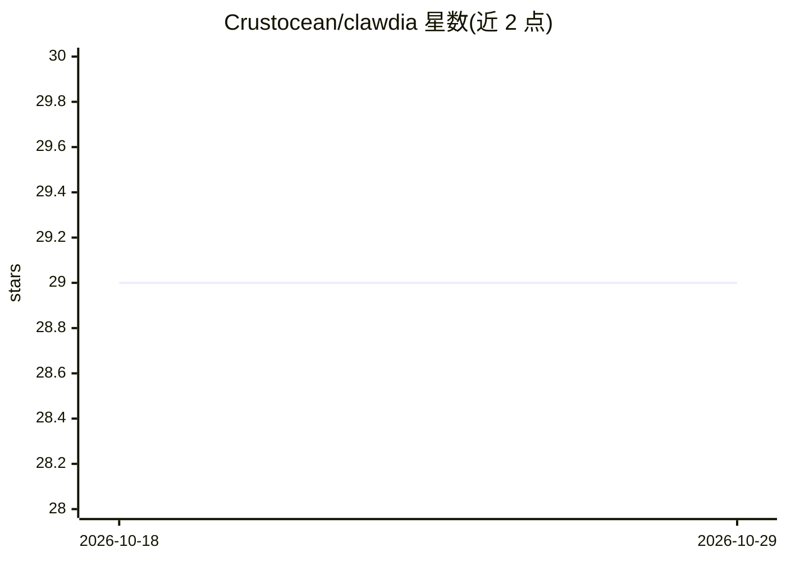

# Crustocean/clawdia

⭐ 29 · JavaScript · 推送 2026-03-06 · [GitHub](https://github.com/Crustocean/clawdia) · [官网](https://crustocean.chat/profile/clawdia) · 组织维护

**Crustocean 聊天平台的 OpenAI 参考聊天 Agent（单文件）**

面向 Crustocean 平台开发者的自治对话 Agent 参考实现：以约 250 行的单个 index.js 连接 Crustocean WebSocket，监听 @提及与私信，拉取最近 18 条消息作为上下文，调用 OpenAI（gpt-4o-mini）生成回复，支持截断自动续写、断线重连后自动重新加入机构、以及来源白名单的 webhook 主动触发。LLM 逻辑隔离在 callOpenAI() 函数，替换后可换 Anthropic、Ollama 等提供商。提供 npm 安装、Docker 与 Railway 一键部署；无状态运行，不需数据库。

## 筛选速览

| 维度 | 判定 | 备注 |
|---|---|---|
| AI 角色 | `ai-ecosystem` | LLM/agent 周边工具 |
| 许可风险 | `permissive` | — |
| 部署形态 | `self-host` | docker 或自建部署 |
| 模型依赖 | — | README 未给出锁定关系 |
| 硬件要求 | — | 无带数字的原话,不猜 |
| 安装摩擦 | `low` | 无编译、无系统依赖或容器化 |
| 成熟度 | — | 结构信号不足 |

## 能力要点

- 单文件运行时（约 250 行），仅两个依赖（@crustocean/sdk 与 dotenv）
- 回复前拉取最近 18 条消息作为上下文
- LLM 调用隔离在 callOpenAI()，可替换为 Anthropic/Ollama 等
- webhook 触发带来源白名单与受众过滤，token 截断自动续写

## 适用场景

- 作为在 Crustocean 上构建自定义 Agent 的起点进行 fork 改造
- 在机构聊天中部署常驻的 @提及/私信自动回复助手
- 通过 webhook 事件触发主动式响应（如房间入住欢迎）

## 场景标签

`聊天机器人` · 领域:对话与助手

## 证据(README 行号)

> L10: An autonomous conversational agent that lives in Crustocean chat. Clawdia joins agencies, listens for @mentions and
> L24: This is the canonical reference implementation for building agents on Crustocean. It is designed to be the first th
> L112: - **Provider boundary isolation.** All LLM logic lives inside `callOpenAI()`. Swap to Anthropic, Ollama, or any pr

## 星数曲线

2026-10-18 29 → 2026-10-29 29（+0）

---
*卡片 v1 · prompt 1.4 · 生成 2026-10-26 · 置信度 high · 依据 README sha `fc70238c892e` · [字段定义](../../DATASET.md)*
