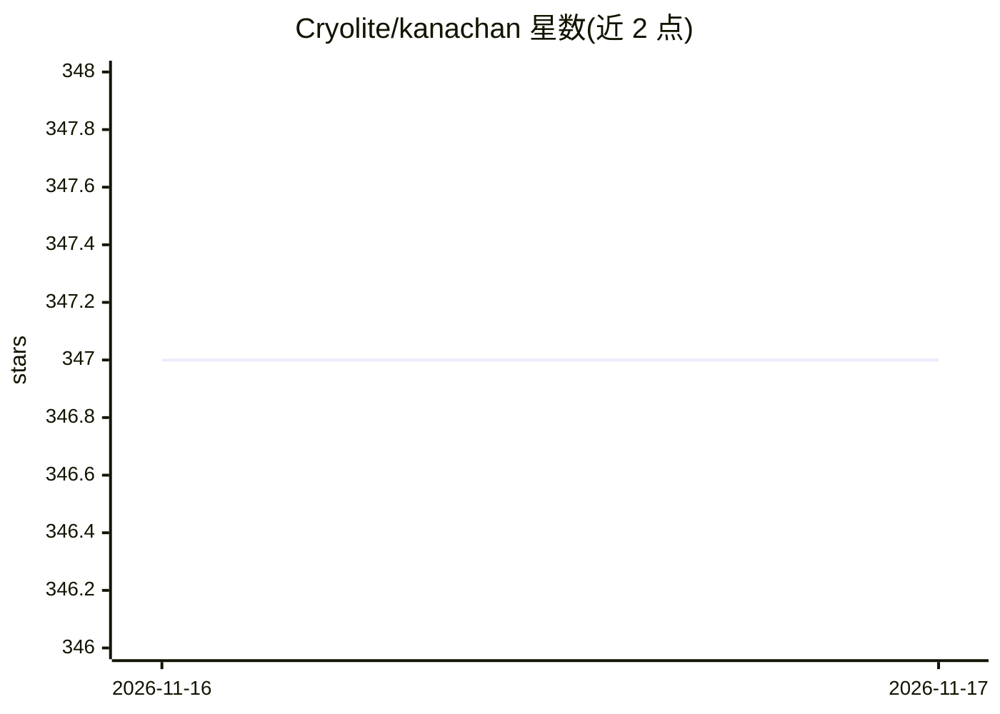

# Cryolite/kanachan

⭐ 347 · Python · 推送 2026-11-14 · [GitHub](https://github.com/Cryolite/kanachan) · 个人维护 · 中文 README

**日本立直麻将 AI 训练框架（含标注、模拟器与训练程序）**

面向 Mahjong Soul 规则的四人立直麻将 AI 研究框架：提供牌谱标注 C++ 工具（提取决策点并转为可学习标注）、向聴数计算用的 LOUDS TRIE 程序、完整复刻 Mahjong Soul 规则（含未成文角落规则）的模拟器库，以及基于 PyTorch 的行为克隆与课程微调训练程序。特征设计几乎不含人工麻将知识，牌全部以 token/embedding 表示，按目标从易到难逐步微调并复用 encoder。仓库不含爬虫、训练数据与已训练模型，用户需自备数据与算力。

## 筛选速览

| 维度 | 判定 | 备注 |
|---|---|---|
| AI 角色 | `ai-native` | 本体是模型或模型工具 |
| 许可风险 | `none` | — |
| 部署形态 | `None` |  |
| 模型依赖 | — | README 未给出锁定关系 |
| 硬件要求 | — | 无带数字的原话,不猜 |
| 安装摩擦 | `low` | 无编译、无系统依赖或容器化 |
| 成熟度 | — | 结构信号不足 |

## 能力要点

- C++ 标注程序将 Mahjong Soul 牌谱转为适合学习的标注
- 完美模拟 Mahjong Soul 标准规则的模拟器（可经 Python 函数调用）
- annotation-vs-simulation 一致性测试框架
- 无人工特征设计 + 分步课程微调（curriculum fine-tuning）训练流程

## 适用场景

- 用自爬的 Mahjong Soul 牌谱训练麻将 AI 模型
- 复现或研究基于 transformer 的端到端麻将 AI 特征设计
- 研究从模仿学习到段位点最大化目标的课程学习

## 场景标签

`微调` `强化学习` · 领域:训练与推理

## 证据(README 行号)

> L4: A Mahjong AI that supports a variant of rules of 4-player Japanese Riichi Mahjong that is adopted in standard games 
> L12: This repository provides an annotation tool for game records of Mahjong Soul, and programs training some types of M
> L84: Implementations of learning programs and prediction modules with PyTorch.

## 星数曲线

2026-11-16 347 → 2026-11-17 347（+0）

---
*卡片 v1 · prompt 1.4 · 生成 2026-11-17 · 置信度 high · 依据 README sha `82d0d10d8c1c` · [字段定义](../../DATASET.md)*
