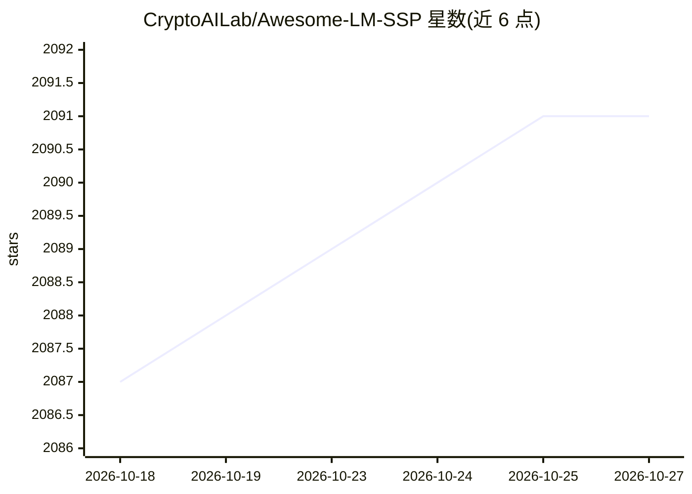

# CryptoAILab/Awesome-LM-SSP

⭐ 2,091 · Apache-2.0 · 推送 2026-09-02 · [GitHub](https://github.com/CryptoAILab/Awesome-LM-SSP) · [官网](https://github.com/CryptoAILab/Awesome-LM-SSP) · 组织维护 · 中文 README

**大模型安全/安全性与隐私研究的论文阅读清单（2467 篇论文）**

由研究者团队维护的大模型可信性资源阅读清单，覆盖安全（Safety）、安全性（Security）、隐私（Privacy）三大维度，共收录 2467 篇论文及书籍、竞赛、排行榜、工具集、综述等条目，重点关注多模态大模型（视觉语言模型与扩散模型）。条目按越狱、对齐、投毒与后门、成员推理攻击、遗忘、水印等细分类别组织，并通过徽章标注模型类型与评语信息。更新方式为社区通过 Issue 与元数据表格提交。仓库标注为持续进行中的手工收集。

## 筛选速览

| 维度 | 判定 | 备注 |
|---|---|---|
| AI 角色 | `ai-knowledge` | 知识聚合/清单类 |
| 许可风险 | `permissive` | Apache-2.0 |
| 部署形态 | `None` |  |
| 模型依赖 | — | README 未给出锁定关系 |
| 硬件要求 | — | 无带数字的原话,不猜 |
| 安装摩擦 | `low` | 无编译、无系统依赖或容器化 |
| 成熟度 | `idea` | |

## 能力要点

- 收录 2467 篇论文，按 Safety/Security/Privacy 三大类约 25 个子类组织
- 额外收录书籍、竞赛、排行榜、33 个工具集、42 篇综述
- 徽章系统标注模型类型（LLM/VLM/SLM/Diffusion）与评语
- 社区通过 Issue 表格与元数据表格提交更新

## 适用场景

- 查找大模型越狱、提示注入、投毒后门等方向的论文
- 调研 LLM/VLM/扩散模型的安全与隐私研究全景
- 获取安全评测相关的工具集与排行榜入口

## 场景标签

`精选清单` · 领域:学习与行业

## 证据(README 行号)

> L9: The resources related to the trustworthiness of large models (LMs) across multiple dimensions (e.g., safety, securit
> L44: - Paper (2467)

## 星数曲线

2026-10-18 2,087 → 2026-10-27 2,091（+4）

---
*卡片 v1 · prompt 1.4 · 生成 2026-10-21 · 置信度 high · 依据 README sha `fb0a5e2fea2d` · [字段定义](../../DATASET.md)*
