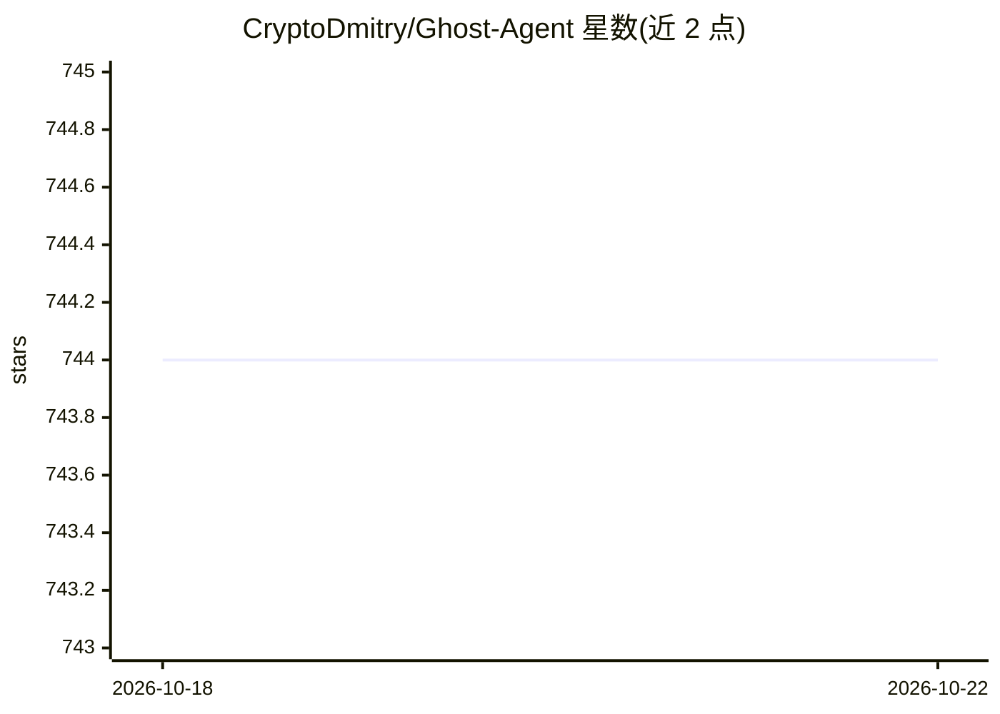

# CryptoDmitry/Ghost-Agent

⭐ 744 · Shell · MIT · 推送 2026-08-25 · [GitHub](https://github.com/CryptoDmitry/Ghost-Agent) · 组织维护 · 中文 README

**Solana 链上的 MCP Agent 工具执行引擎，支持 CLI/API/Telegram**

Coreon-MCP-Execution-Engine 为结构化 ToolCall 链提供统一运行时：Planner 用 LLM 意图识别将自然语言解析为 JSON 执行计划，Executor 逐步或并行执行工具并处理重试与错误恢复，Tool Registry 集中管理工具声明与元数据，可经 CLI、HTTP API、Telegram Bot 三种模式交互。通过 Docker 镜像分发，需配置 OPENAI_API_KEY，另检测付费 API 的 HTTP 信号并暂停执行提示付款，支持 Solana 余额/代币/DeFi/合约查询。自主 Agent 支付为路线图未实现。

## 筛选速览

| 维度 | 判定 | 备注 |
|---|---|---|
| AI 角色 | `ai-ecosystem` | LLM/agent 周边工具 |
| 许可风险 | `permissive` | MIT |
| 部署形态 | `self-host` | docker 或自建部署 |
| 模型依赖 | — | README 未给出锁定关系 |
| 硬件要求 | — | 无带数字的原话,不猜 |
| 安装摩擦 | `low` | 无编译、无系统依赖或容器化 |
| 成熟度 | `idea` | |

## 能力要点

- Planner/Executor/Tool Registry 三模块的 ToolCall 链执行架构
- CLI / API Server / Telegram Bot 三种内置运行模式
- 检测付费 API HTTP 信号并挂起执行提示付款
- Docker 镜像分发，支持 Solana 余额/元数据/DeFi/合约调用

## 适用场景

- 为 LLM agent 提供解耦的后端工具执行引擎
- 通过 Telegram 或 CLI 以自然语言触发工具链
- Web3/Solana 场景下做链上查询与混合工作流执行

## 场景标签

`Agent 框架` · 领域:Agent 开发

## 证据(README 行号)

> L35: **Coreon-MCP-Execution-Engine** provides a unified runtime for structured `ToolCall` chains. It allows LLM agents o
> L45: This project is inspired by the idea of decoupling **agent planning** from **tool execution**, making it perfect fo

## 星数曲线

2026-10-18 744 → 2026-10-22 744（+0）

---
*卡片 v1 · prompt 1.4 · 生成 2026-10-21 · 置信度 high · 依据 README sha `7c417fc6b974` · [字段定义](../../DATASET.md)*
