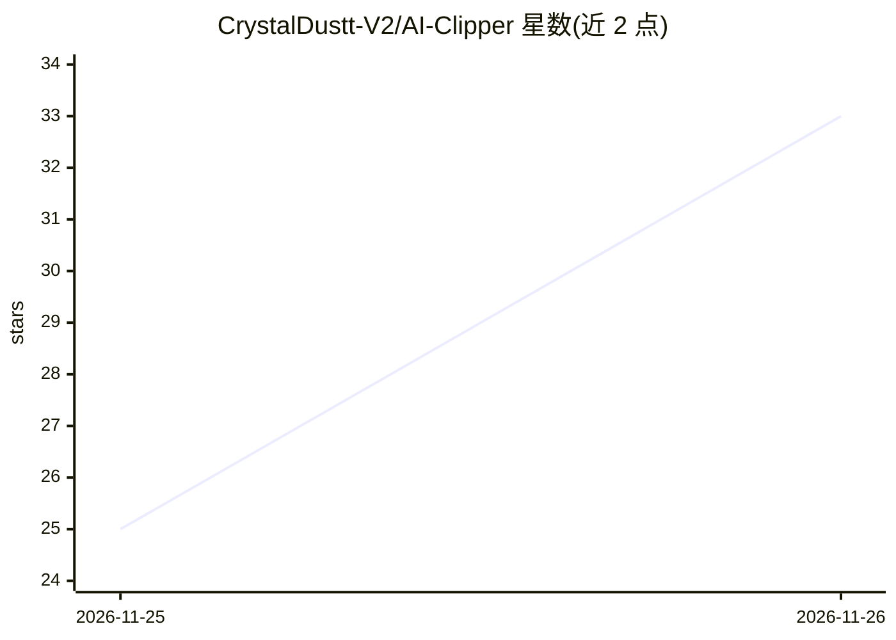

# CrystalDustt-V2/AI-Clipper

⭐ 33 · Python · MIT · 推送 2026-11-22 · [GitHub](https://github.com/CrystalDustt-V2/AI-Clipper) · 个人维护

**本地视频智能剪辑 CLI：AI 分析并生成剪辑工程，FFmpeg 确定性渲染**

本地优先的 Python 命令行工具：AI agent 读取转录与视觉时间线，生成严格 JSON 的剪辑工程格式 CEP 1.0，经 Pydantic v2 校验后由本地工具执行媒体变换与渲染，AI 输出不作为 shell 命令执行。功能覆盖话题驱动的片段时长决策、MediaPipe 人脸检测驱动的自动重构图、10 种字幕预设、多轨合成与音频处理。渲染接受仅限 READY_TO_RENDER 或 COMPLETED 状态的工程，支持配置 Ollama 或 OpenAI 兼容端点。

## 筛选速览

| 维度 | 判定 | 备注 |
|---|---|---|
| AI 角色 | `ai-native` | 本体是模型或模型工具 |
| 许可风险 | `permissive` | MIT |
| 部署形态 | `None` |  |
| 模型依赖 | local-ok | 支持本地模型 |
| 硬件要求 | — | 无带数字的原话,不猜 |
| 安装摩擦 | `medium` | 含编译或系统依赖之一 |
| 成熟度 | — | 结构信号不足 |

## 能力要点

- AI 生成严格校验的 CEP 1.0 剪辑工程，本地 FFmpeg 确定性渲染
- MediaPipe 人脸/说话人检测驱动的自动重构图（crop/fit_blur/split_2up/webcam_top）
- 10 种字幕预设、B-roll 叠加、11 种转场与音频响度归一化
- 支持本地 Ollama 与 OpenAI 兼容端点，提供 provider-check 兼容性检查

## 适用场景

- 把长视频自动切分成带字幕的竖屏短视频
- 播客/访谈视频的说话人自动跟焦与分屏重构图
- 无浏览器界面的本地自动化视频剪辑流水线

## 场景标签

`视频生成` · 领域:内容生成

## 证据(README 行号)

> L3: A local-first Python CLI for video intelligence, structured AI-controlled video editing, and deterministic FFmpeg re
> L19: - **Deterministic Validation & Fault-Tolerant Agent Loop**:
> L74: ### OpenAI-Compatible Endpoint

## 星数曲线

2026-11-25 25 → 2026-11-26 33（+8）

---
*卡片 v1 · prompt 1.4 · 生成 2026-11-24 · 置信度 high · 依据 README sha `0332ad5e926f` · [字段定义](../../DATASET.md)*
