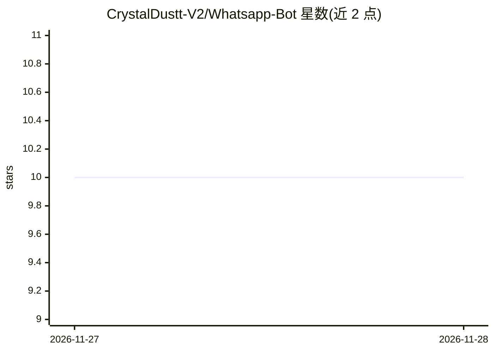

# CrystalDustt-V2/Whatsapp-Bot

⭐ 10 · TypeScript · MIT · 推送 2026-10-08 · [GitHub](https://github.com/CrystalDustt-V2/Whatsapp-Bot) · [官网](https://crystaldust-v0.vercel.app) · 个人维护

**个人 WhatsApp 账号的 TypeScript 混合机器人框架**

基于 Baileys 连接普通 WhatsApp 账号，让人与机器人可同时使用同一账号：前缀命令、QR/配对码登录、Express 状态页与私有登录页。功能覆盖 AI 聊天、图像/音频处理、语音转文本、embedding 与工具调用，贴纸创建与编辑，基于 Sharp/FFmpeg 的媒体处理，yt-dlp 下载助手，删除消息恢复，以及 Prisma/PostgreSQL 与 Redis/BullMQ 脚手架。后端需运行在常驻 VPS、面板主机或容器，静态托管无法承载长连接。MIT 许可。

## 筛选速览

| 维度 | 判定 | 备注 |
|---|---|---|
| AI 角色 | `ai-native` | 本体是模型或模型工具 |
| 许可风险 | `permissive` | MIT |
| 部署形态 | `self-host` | docker 或自建部署 |
| 模型依赖 | — | README 未给出锁定关系 |
| 硬件要求 | — | 无带数字的原话,不猜 |
| 安装摩擦 | `low` | 无编译、无系统依赖或容器化 |
| 成熟度 | — | 结构信号不足 |

## 能力要点

- AI 聊天、图像、语音转文本、embedding 与工具调用支持
- QR 登录与可选手机号配对码登录
- 删除消息元数据/媒体恢复，可选 MEGA 存储
- Docker Compose 部署与 Lunafy/HidenCloud 面板启动脚本

## 适用场景

- 把个人 WhatsApp 账号变成可响应命令的机器人
- 在 WhatsApp 中使用 AI 聊天与语音转文本
- 恢复群内被删除的可解密消息媒体

## 场景标签

`聊天机器人` `语音识别` `图像视频处理` · 领域:对话与助手

## 证据(README 行号)

> L22: - AI chat, image, audio, speech-to-text, embedding, and tool-calling support
> L5: CrystalDust V0 is a TypeScript WhatsApp hybrid bot. It connects to a normal
> L6: WhatsApp account through WhatsApp Web/Baileys, then lets that account keep being

## 星数曲线

2026-11-27 10 → 2026-11-28 10（+0）

---
*卡片 v1 · prompt 1.4 · 生成 2026-11-27 · 置信度 high · 依据 README sha `de2d96fb48fe` · [字段定义](../../DATASET.md)*
