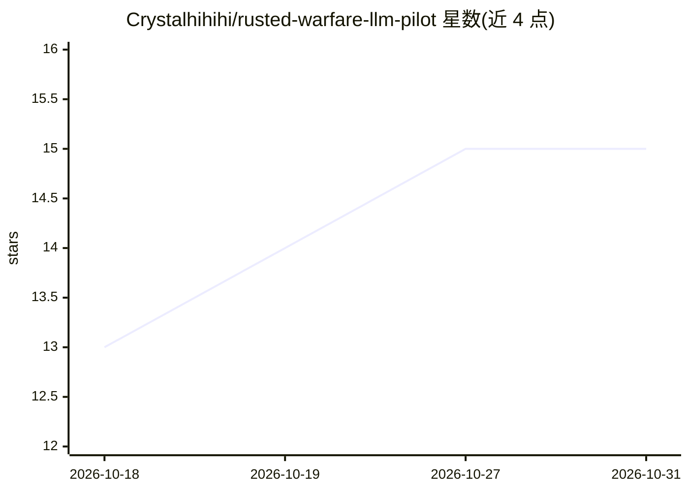

# Crystalhihihi/rusted-warfare-llm-pilot

⭐ 15 · Python · NOASSERTION · 推送 2026-10-19 · [GitHub](https://github.com/Crystalhihihi/rusted-warfare-llm-pilot) · 个人维护 · 中文 README

**把 LLM 接入铁锈战争的单机 AI 指挥链研究项目**

单机研究项目：通过 Java javaagent 随游戏 JVM 挂载（不改游戏文件），用字节码 hook 与反射每 0.5 秒提取战场快照（单位/资金/迷雾/ASCII 地图等），经 TCP NDJSON 交给 Python 桥接层；分层多 agent 指挥链由 LLM 产出 JSON 计划与工单，规则层与反射层兜底执行，指令经游戏原生命令队列回注。面向 RTS 游戏 AI 与闭源 JVM 游戏逆向研究开发者。README 明确标注实验阶段、严禁用于多人对战；已知问题包括进攻性不足、部分闭环未跑通、反射目标随游戏版本可能失效。DeepSeek 为默认配置的模型接入。

## 筛选速览

| 维度 | 判定 | 备注 |
|---|---|---|
| AI 角色 | `ai-native` | 本体是模型或模型工具 |
| 许可风险 | `permissive` | NOASSERTION |
| 部署形态 | `None` |  |
| 模型依赖 | locked-api |  |
| 硬件要求 | — | 无带数字的原话,不猜 |
| 安装摩擦 | `medium` | 含编译或系统依赖之一 |
| 成熟度 | `idea` | |

## 能力要点

- 无侵入 javaagent 实时提取战场快照（0.5s/跳，TCP NDJSON 输出）
- 分层指挥链：总指挥/建造指挥出计划，中层 agent 与规则层/反射层执行
- 公平性设计：只转发本队视野内信息、指令走原生命令队列、限速拟人 APM
- 浏览器总控台（127.0.0.1:8321）展示计划书、工单与迷雾三态地图

## 适用场景

- 研究 LLM 在 RTS 游戏中的分层决策与指挥链架构
- 复用这套数据通道做 Java/libGDX 闭源游戏的取数研究
- 在单机环境观察 LLM 指挥 AI 对局并复盘工程记录

## 场景标签

`多智能体` · 领域:Agent 开发

## 证据(README 行号)

> L20: 将大语言模型接入即时战略游戏《铁锈战争》（Rusted Warfare）的单机研究项目：
> L30: 指挥链是"LLM 慢思考出意图、确定性层快执行"的分层异步结构：总指挥与建造指挥（flash）

## 星数曲线

2026-10-18 13 → 2026-10-31 15（+2）

---
*卡片 v1 · prompt 1.4 · 生成 2026-10-31 · 置信度 high · 依据 README sha `113752e29e4b` · [字段定义](../../DATASET.md)*
