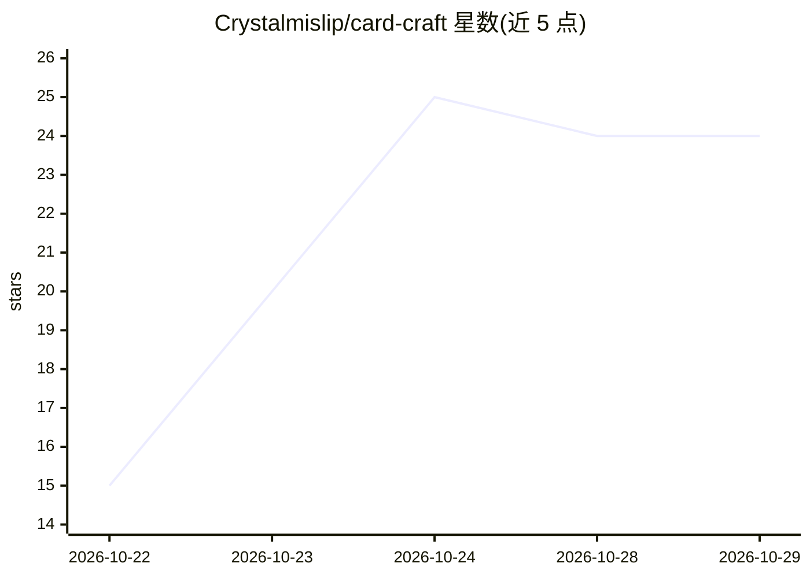

# Crystalmislip/card-craft

⭐ 24 · C# · MIT · 推送 2026-10-18 · [GitHub](https://github.com/Crystalmislip/card-craft) · 个人维护

**Windows 本地 LLM 闪卡生成器：把笔记和 PDF 变成 Anki 卡片**

面向 Windows 10/11 的免费开源闪卡制作工具：粘贴笔记文本或章节 PDF，由本地模型（经 llama.cpp 运行，离线）生成问答对与填空（cloze）卡片，每张卡片保留页码与段落来源锚点，支持整本教材文件夹批量处理并按章节生成带标签的牌组。用户以纯键盘流程审核、编辑或拒绝每张草稿卡，随后导出为可导入 Anki 的 CSV 或 APKG 式包。以约 100 MB 免安装单文件 exe 分发，也可用 .NET 8 SDK 自行构建；无广告、无账号、无遥测。

## 筛选速览

| 维度 | 判定 | 备注 |
|---|---|---|
| AI 角色 | `ai-native` | 本体是模型或模型工具 |
| 许可风险 | `permissive` | MIT |
| 部署形态 | `None` |  |
| 模型依赖 | — | README 未给出锁定关系 |
| 硬件要求 | — | 无带数字的原话,不猜 |
| 安装摩擦 | `medium` | 含编译或系统依赖之一 |
| 成熟度 | — | 结构信号不足 |

## 能力要点

- 本地 LLM（llama.cpp 运行时）离线生成问答对与 cloze 填空卡
- 每张卡片保留来源页码与段落锚点以便核验
- 教材文件夹批量处理并按章节生成带标签的牌组
- 100 MB 单文件免安装 exe，CSV/APKG 式导出

## 适用场景

- 我想把讲义或教材 PDF 离线转成 Anki 卡片而不上传云端
- 对 AI 草稿卡片逐张审核编辑后再导入 Anki
- 整本教材按章节批量生成带标签的牌组

## 场景标签

`AI 写作` · 领域:内容生成

## 证据(README 行号)

> L3: 🃏 Free, open-source flashcard maker for Windows — turn notes and PDFs into Anki-ready cards with a local LLM. 100 MB
> L11: - ✅ **Notes to cards** — paste lecture text or a chapter PDF and get question-answer pairs back from a local model
> L17: - ✅ **100 MB self-contained exe** — runtime bundled, model runs locally via llama.cpp, offline, MIT

## 星数曲线

2026-10-22 15 → 2026-10-29 24（+9）

---
*卡片 v1 · prompt 1.4 · 生成 2026-10-27 · 置信度 high · 依据 README sha `19b8e7400b00` · [字段定义](../../DATASET.md)*
