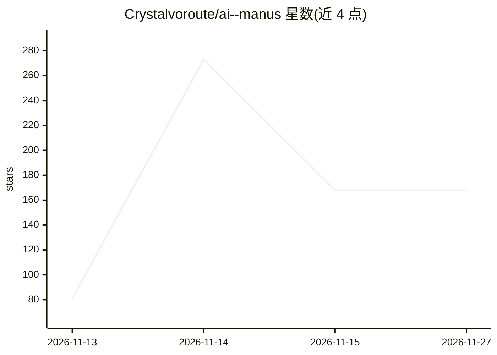

# Crystalvoroute/ai--manus

⭐ 168 · Apache-2.0 · 推送 2026-11-15 · [GitHub](https://github.com/Crystalvoroute/ai--manus) · 个人维护

**面向个人用户的自主 AI Agent：代跑代码与控制浏览器完成任务**

Manus 是一个自主 AI Agent，代替用户编写并执行脚本、控制浏览器（导航网页、填写表单、采集信息）并执行多步骤任务，定位为家庭、学习与轻量办公场景的助手，而非企业级平台。README 描述其可在后台运行、跨会话复用任务模式，并给出最低配置（双核 CPU、4 GB 内存）与准备、配置、测试、逐步放手的上手流程。但 README 为营销式介绍，未给出具体安装命令、支持的模型供应商或代码结构等技术细节。

## 筛选速览

| 维度 | 判定 | 备注 |
|---|---|---|
| AI 角色 | `ai-native` | 本体是模型或模型工具 |
| 许可风险 | `permissive` | Apache-2.0 |
| 部署形态 | `None` |  |
| 模型依赖 | — | README 未给出锁定关系 |
| 硬件要求 | — | 无带数字的原话,不猜 |
| 安装摩擦 | `low` | 无编译、无系统依赖或容器化 |
| 成熟度 | — | 结构信号不足 |

## 能力要点

- 自主编写并执行代码完成任务
- 浏览器控制：导航网页、填表、采集信息
- 脚本与浏览器动作可在同一任务流中衔接
- 声明面向小规模场景（家庭/学习/轻办公）而非企业平台

## 适用场景

- 让 agent 代为完成查网页、填表单等重复操作
- 学习与研究中收集资料、跑小脚本、整理笔记
- 小型项目中把重复性步骤交给后台 agent 执行

## 场景标签

`浏览器自动化` `编码 Agent` `AI 助手` · 领域:效率与自动化

## 证据(README 行号)

> L10: - **Autonomous Code Execution:** Manus AI agent runs code on its own to complete tasks, so you can focus on decisio
> L18: Manus is an autonomous AI agent designed to run code and control a browser on your behalf. Instead of acting like a

## 星数曲线

2026-11-13 81 → 2026-11-27 168（+87）

---
*卡片 v1 · prompt 1.4 · 生成 2026-11-17 · 置信度 mid · 依据 README sha `fbfd5e977bf4` · [字段定义](../../DATASET.md)*
