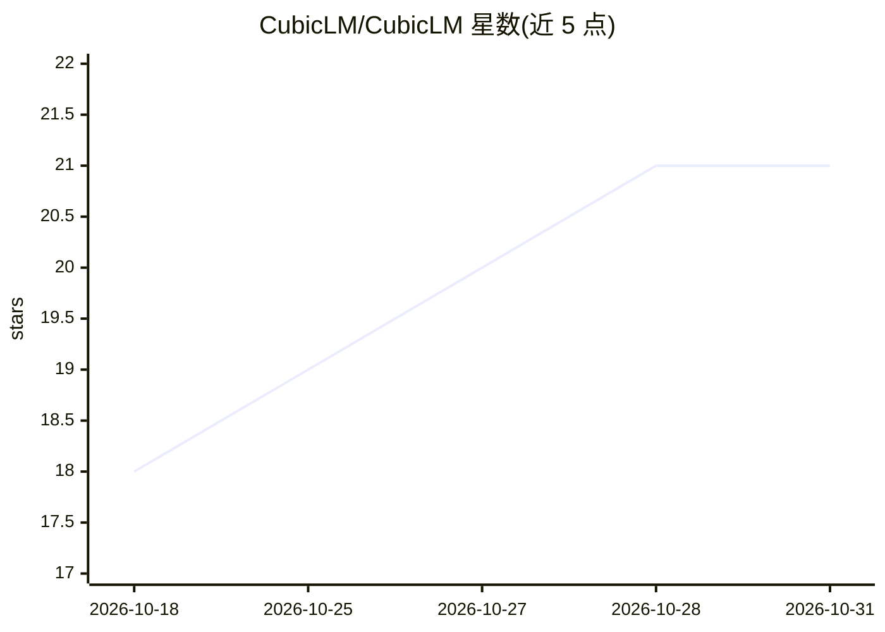

# CubicLM/CubicLM

⭐ 21 · C++ · MIT · 推送 2026-10-17 · [GitHub](https://github.com/CubicLM/CubicLM) · [官网](https://cubiclm.vercel.app) · 组织维护

**跨平台本地 AI 聊天应用：Android/Windows 端侧推理+多云接入**

单一 Flutter 代码库的 AI 聊天客户端，发布为 Android 应用与 Windows 桌面应用（Web 版计划中）。本地推理通过 llama.cpp（GGUF、Vulkan/OpenCL GPU 加速）与 Google LiteRT-LM 运行时实现，支持端侧 Stable Diffusion 1.5 图像生成与 Qwen2-VL 等视觉模型；另可连接 23+ 云端服务商。内置 OpenAI 兼容 API 服务器（端口 8080），支持 Skills 扩展与 MCP、网页内容抓取注入上下文。设备智能层按 RAM 分层自动配置上下文并提供 SoC 识别。限制：LiteRT 上下文受硬件限制 4K，Windows 本地推理依赖 llama-server sidecar。

## 筛选速览

| 维度 | 判定 | 备注 |
|---|---|---|
| AI 角色 | `ai-native` | 本体是模型或模型工具 |
| 许可风险 | `permissive` | MIT |
| 部署形态 | `desktop` | 安装包/桌面程序 |
| 模型依赖 | local-ok | 支持本地模型 |
| 硬件要求 | — | 无带数字的原话,不猜 |
| 安装摩擦 | `medium` | 含编译或系统依赖之一 |
| 成熟度 | — | 结构信号不足 |

## 能力要点

- llama.cpp（Vulkan/OpenCL）与 LiteRT-LM 双本地推理引擎，GPU 失败自动回退 CPU
- 端侧 Stable Diffusion 1.5 图像生成（Isolate 处理保持 60fps UI）
- 23+ 云服务商接入与内置 OpenAI 兼容 API 服务器（端口 8080）
- 按 RAM 分层自动调参、SoC 识别与量化推荐

## 适用场景

- 在 Android 手机上离线运行 GGUF/LiteRT 模型聊天
- 同一应用内切换本地与云端模型对话
- 把手机变成家庭实验室的 OpenAI 兼容接口
- 在对话中抓取网页链接内容做摘要或事实核对

## 场景标签

`聊天机器人` `图像生成` `推理引擎` · 领域:对话与助手

## 证据(README 行号)

> L49: > 📱⚡ A cross-platform AI chat application with local on-device inference and multi-provider cloud AI support. Runs 
> L63: - 🔒 **Full offline capability** — download a model once, chat forever without internet

## 星数曲线

2026-10-18 18 → 2026-10-31 21（+3）

---
*卡片 v1 · prompt 1.4 · 生成 2026-10-28 · 置信度 high · 依据 README sha `96e5452b1142` · [字段定义](../../DATASET.md)*
