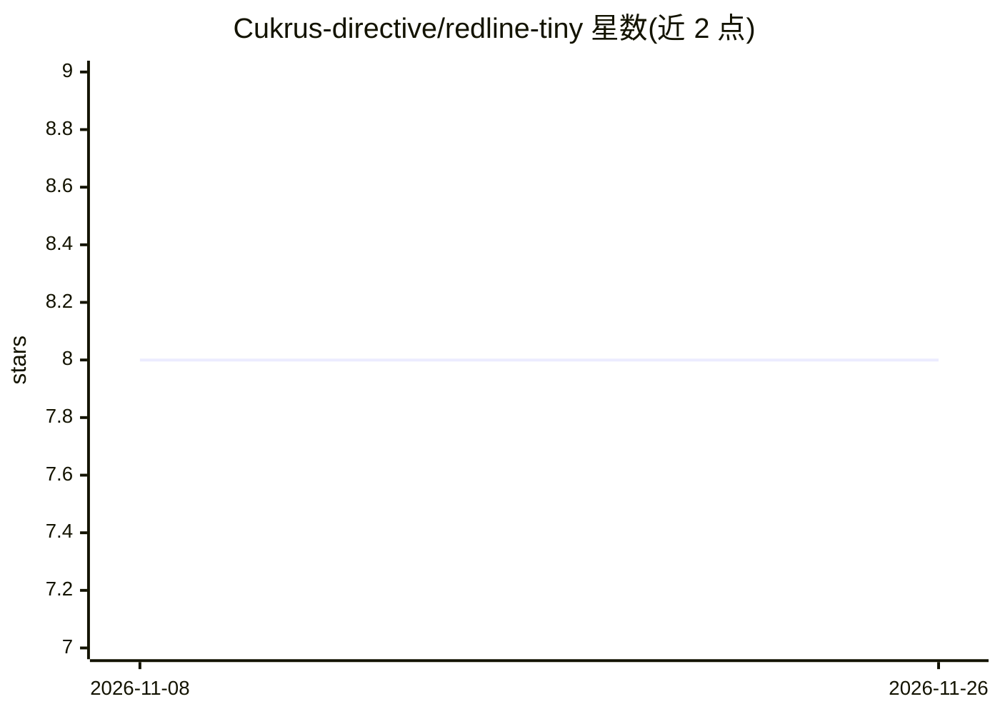

# Cukrus-directive/redline-tiny

⭐ 8 · Python · Apache-2.0 · 推送 2026-11-06 · [GitHub](https://github.com/Cukrus-directive/redline-tiny) · [官网](https://huggingface.co/spaces/cukrus/redline-tiny) · 个人维护

**在 Windows 笔记本 NPU 上本地运行图像生成与编辑的应用**

redline-tiny 是一个面向配备 AMD XDNA2 NPU 的 Windows 11 笔记本的本地图像生成与编辑应用：整条 Qwen-Image-2.1-Turbo 流水线（Qwen3-VL-8B 文本编码器、32 块 DiT、VAE 解码器）运行在 NPU 上，iGPU 编码输入照片，CPU 仅做胶水逻辑。提供本地 Web 界面（照片编辑、文生图、before/after 对比、历史记录、PNG+JSON 保存）与 OpenAI 风格的本地 API。输出可用相同 prompt 与 seed 复现。限制：需特定 Ryzen AI 300 系芯片、32 GB 内存、指定版本的 NPU 驱动。

## 筛选速览

| 维度 | 判定 | 备注 |
|---|---|---|
| AI 角色 | `ai-native` | 本体是模型或模型工具 |
| 许可风险 | `permissive` | Apache-2.0 |
| 部署形态 | `None` |  |
| 模型依赖 | — | README 未给出锁定关系 |
| 硬件要求 | — | 无带数字的原话,不猜 |
| 安装摩擦 | `low` | 无编译、无系统依赖或容器化 |
| 成熟度 | — | 结构信号不足 |

## 能力要点

- Qwen3-VL-8B 编码器、32 块 DiT 与 VAE 解码器全部运行在 XDNA2 NPU 上
- 提供本地 Web 界面与 OpenAI 风格 API（/v1/images/edits、/v1/images/generations）
- 相同 prompt、seed 与照片每次输出相同字节，结果可复现
- 权重以 bfp16 块浮点格式存储，矩阵乘在 32 个 AIE 核上运行

## 适用场景

- 在没有 GPU 的笔记本上离线生成和编辑图片
- 用自然语言指令修改照片（改颜色、转水彩、跨图搬移对象）
- 为脚本和其他应用提供本地图像生成 API 接口

## 场景标签

`图像生成` · 领域:内容生成

## 证据(README 行号)

> L3:  Qwen-Image-2.1-Turbo photo editing and text-to-image, running on the Ryzen AI NPU of an ordinary Windows laptop.
> L23: - **A local web interface.** Drop in a photo and type what should change, or describe a new image. There's a before
> L24: - **The whole model on the NPU.** The Qwen3-VL-8B text encoder, the 32-block DiT and the VAE decoder all run on the

## 星数曲线

2026-11-08 8 → 2026-11-26 8（+0）

---
*卡片 v1 · prompt 1.4 · 生成 2026-11-20 · 置信度 high · 依据 README sha `186244d9be84` · [字段定义](../../DATASET.md)*
