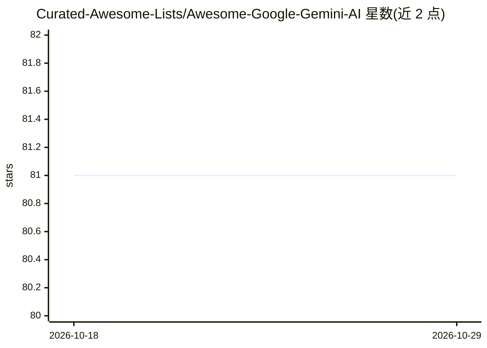

# Curated-Awesome-Lists/Awesome-Google-Gemini-AI

⭐ 81 · Apache-2.0 · 推送 2026-09-04 · [GitHub](https://github.com/Curated-Awesome-Lists/Awesome-Google-Gemini-AI) · 个人维护

**Google Gemini AI 资源策展清单：项目、文章、课程与书籍**

面向关注 Google Gemini 的开发者与学习者的 awesome 清单，收录 GitHub 项目（聊天应用、各语言 SDK 客户端、Telegram 机器人等）、文章博客、在线课程与书籍四类资源。README 简介说明 Gemini 为多模态 LLM，含 Nano/Pro/Ultra 三档版本。作者注明 Gemini 尚处早期阶段，清单会定期更新。条目附星级评分，但无统一安装或使用说明，资源各自跳转外部仓库。

## 筛选速览

| 维度 | 判定 | 备注 |
|---|---|---|
| AI 角色 | `ai-knowledge` | 知识聚合/清单类 |
| 许可风险 | `permissive` | Apache-2.0 |
| 部署形态 | `None` |  |
| 模型依赖 | locked-api |  |
| 硬件要求 | — | 无带数字的原话,不猜 |
| 安装摩擦 | `low` | 无编译、无系统依赖或容器化 |
| 成熟度 | — | 结构信号不足 |

## 能力要点

- 收录 LibreChat、casibase、generative-ai-python 等 GitHub 项目条目
- 按 GitHub 项目/文章/在线课程/书籍四类组织
- 条目附星级评分与外部链接

## 适用场景

- 寻找接入 Gemini API 的多语言 SDK 与客户端库
- 查找 Gemini 相关教程、课程与书籍进行学习
- 了解 Gemini 生态内的开源聊天应用与机器人项目

## 场景标签

`精选清单` · 领域:学习与行业

## 证据(README 行号)

> L11: ## GitHub projects
> L34: ## Articles & Blogs
> L57: ## Online Courses
> L76: ## Books

## 星数曲线

2026-10-18 81 → 2026-10-29 81（+0）

---
*卡片 v1 · prompt 1.4 · 生成 2026-10-24 · 置信度 high · 依据 README sha `6bef82e3131a` · [字段定义](../../DATASET.md)*
