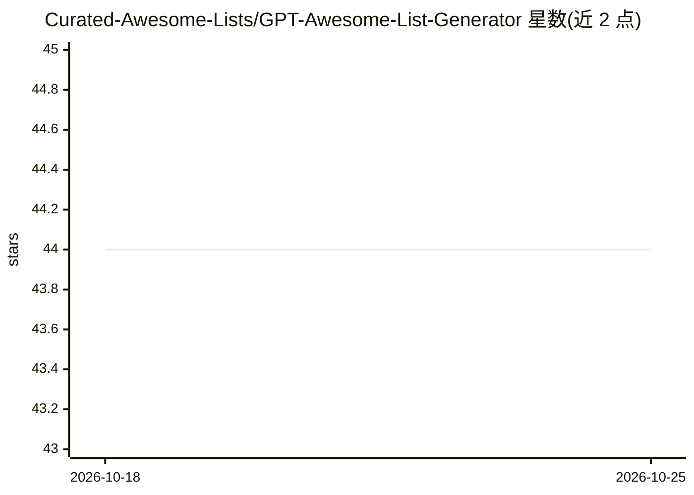

# Curated-Awesome-Lists/GPT-Awesome-List-Generator

⭐ 44 · Python · MIT · 推送 2026-10-24 · [GitHub](https://github.com/Curated-Awesome-Lists/GPT-Awesome-List-Generator) · 个人维护

**用 GPT 模型按关键词自动生成 awesome list 的 Python 工具**

Python 程序：输入关键词与描述，从 GitHub、Google Scholar、YouTube、播客等来源抓取资源，再由所选 GPT 模型（如 GPT-3.5/4）按相关性过滤、排序并生成 Markdown 格式的资源清单。分两阶段运行：数据抓取与 LLM 批量处理，批量大小与结果数量可配置。需 Python 3.10、Poetry 安装依赖，并配置 OPENAI_API_KEY 与 Google Cloud Custom Search API 凭证；提供 Streamlit UI 与直接代码调用两种使用方式。

## 筛选速览

| 维度 | 判定 | 备注 |
|---|---|---|
| AI 角色 | `ai-native` | 本体是模型或模型工具 |
| 许可风险 | `permissive` | MIT |
| 部署形态 | `None` |  |
| 模型依赖 | — | README 未给出锁定关系 |
| 硬件要求 | — | 无带数字的原话,不猜 |
| 安装摩擦 | `low` | 无编译、无系统依赖或容器化 |
| 成熟度 | — | 结构信号不足 |

## 能力要点

- 多源抓取：GitHub（按 star 排序）、Google Scholar（按引用排序）、YouTube、播客等专用爬虫
- GPT 模型过滤、排序资源并生成 Markdown 清单，模型可选
- 抓取与处理均分批执行，批量大小与结果数量可配置
- 提供 Streamlit Web UI 与 AwesomeListGenerator 类两种使用途径

## 适用场景

- 为一个主题快速生成含项目、论文、视频、播客的资源清单
- 研究者或开发者收集某领域的学习与参考资料
- 以代码方式批量生成多个关键词的 Markdown 资源页

## 场景标签

`网页抓取` `AI 写作` · 领域:效率与自动化

## 证据(README 行号)

> L7: using GPT models; you can choose between different models to generate the list, such as
> L134: Once the data is scraped, it is passed on to the data processing phase. In this phase, the program uses the select

## 星数曲线

2026-10-18 44 → 2026-10-25 44（+0）

---
*卡片 v1 · prompt 1.4 · 生成 2026-10-25 · 置信度 high · 依据 README sha `640831d09c3d` · [字段定义](../../DATASET.md)*
