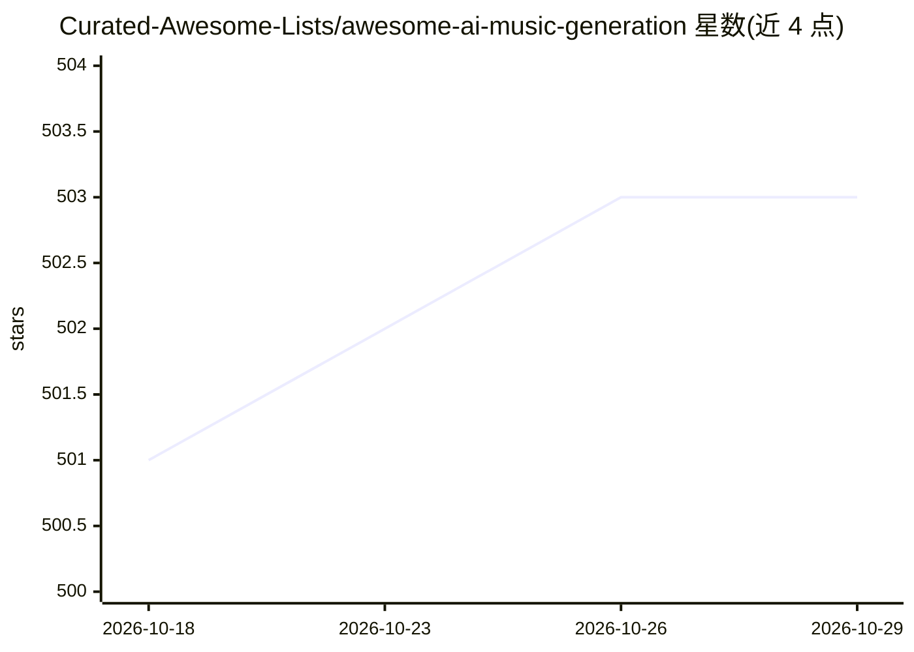

# Curated-Awesome-Lists/awesome-ai-music-generation

⭐ 503 · Apache-2.0 · 推送 2026-09-04 · [GitHub](https://github.com/Curated-Awesome-Lists/awesome-ai-music-generation) · 组织维护

**AI 音乐生成资源策展清单：项目、论文、课程与书籍**

一个 awesome 风格的策展清单，汇集 AI 生成音乐领域的资源：23 个 GitHub 项目（如 Magenta、Audiocraft/MusicGen、riffusion、AudioLDM2 等，附星数）、约 20 篇文章与博客、4 门在线课程、4 本书和 7 篇研究论文。面向音乐人、研究者与希望集成 AI 音乐能力的开发者，按 GitHub 项目、文章、课程、书籍、论文分节组织，条目附一句话简介，不提供代码或安装途径。

## 筛选速览

| 维度 | 判定 | 备注 |
|---|---|---|
| AI 角色 | `ai-knowledge` | 知识聚合/清单类 |
| 许可风险 | `permissive` | Apache-2.0 |
| 部署形态 | `None` |  |
| 模型依赖 | — | README 未给出锁定关系 |
| 硬件要求 | — | 无带数字的原话,不猜 |
| 安装摩擦 | `low` | 无编译、无系统依赖或容器化 |
| 成熟度 | — | 结构信号不足 |

## 能力要点

- 收录 23 个 AI 音乐生成 GitHub 项目并附星数与简介
- 覆盖研究论文、综述文章、书籍与在线课程四类学习资源
- 按项目/文章/课程/书籍/论文五节组织条目

## 适用场景

- 寻找可用的 AI 音乐生成开源项目
- 系统学习该领域的研究论文与书籍
- 为课程或选型调研收集资源线索

## 场景标签

`精选清单` · 领域:学习与行业

## 证据(README 行号)

> L3: Welcome to the Awesome Music Generation with AI list, a curated collection of resources, projects, and frameworks at
> L11: - Magenta: Music and Art Generation with Machine Intelligence 🎵🖌️ (18712 stars)

## 星数曲线

2026-10-18 501 → 2026-10-29 503（+2）

---
*卡片 v1 · prompt 1.4 · 生成 2026-10-21 · 置信度 high · 依据 README sha `bd57dc3eb45b` · [字段定义](../../DATASET.md)*
