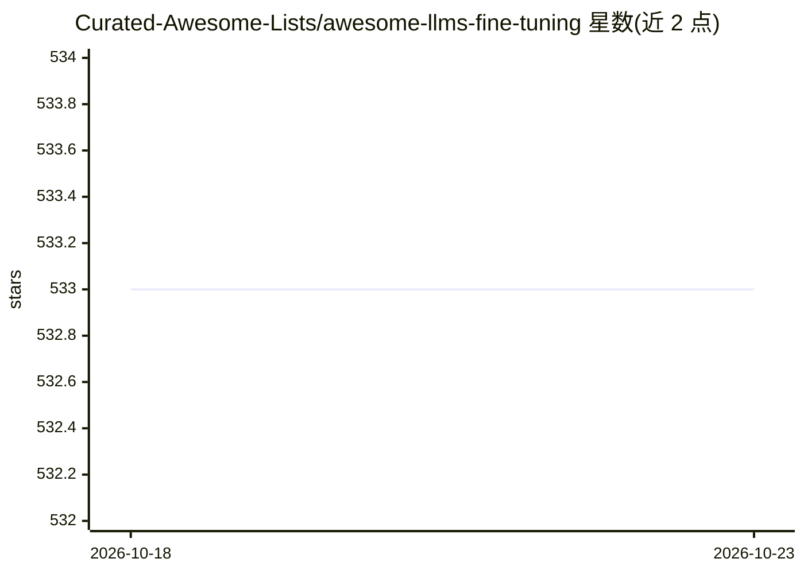

# Curated-Awesome-Lists/awesome-llms-fine-tuning

⭐ 533 · 推送 2026-09-04 · [GitHub](https://github.com/Curated-Awesome-Lists/awesome-llms-fine-tuning) · 组织维护

**LLM 微调资源策展清单：教程、论文、工具与课程汇编**

面向研究人员、数据科学家与机器学习从业者的 LLM 微调主题 awesome list：收录 20+ 个 GitHub 微调框架与工具（含 star 数标注）、20+ 篇文章博客、10+ 门在线课程与书籍条目，内容覆盖 LoRA/QLoRA、RLHF/DPO、RAG 对比、企业数据微调等主题。仓库本身为纯清单，不提供可安装运行的软件，条目仅含链接与简介。

## 筛选速览

| 维度 | 判定 | 备注 |
|---|---|---|
| AI 角色 | `ai-knowledge` | 知识聚合/清单类 |
| 许可风险 | `none` | — |
| 部署形态 | `None` |  |
| 模型依赖 | — | README 未给出锁定关系 |
| 硬件要求 | — | 无带数字的原话,不猜 |
| 安装摩擦 | `low` | 无编译、无系统依赖或容器化 |
| 成熟度 | — | 结构信号不足 |

## 能力要点

- 收录 AutoTrain、LLaMA-Factory、H2O LLM Studio 等 20+ 个微调框架与工具条目（附 star 数）
- 汇编微调主题文章博客，覆盖 QLoRA、RLHF/DPO、RAG vs 微调等议题
- 收录 Udemy/Coursera/edX 在线课程与书籍条目

## 适用场景

- 寻找可用的 LLM 微调框架与工具
- 系统学习 LLM 微调方法与最佳实践
- 对比微调与 RAG 等方案的参考资料查找

## 场景标签

`精选清单` · 领域:学习与行业

## 证据(README 行号)

> L3: Welcome to the curated collection of resources for fine-tuning Large Language Models (LLMs) like GPT, BERT, RoBERTa,
> L7: In this awesome list, we have meticulously compiled a range of resources, including tutorials, papers, tools, framew
> L11: ## GitHub projects

## 星数曲线

2026-10-18 533 → 2026-10-23 533（+0）

---
*卡片 v1 · prompt 1.4 · 生成 2026-10-22 · 置信度 high · 依据 README sha `699bdcafe040` · [字段定义](../../DATASET.md)*
