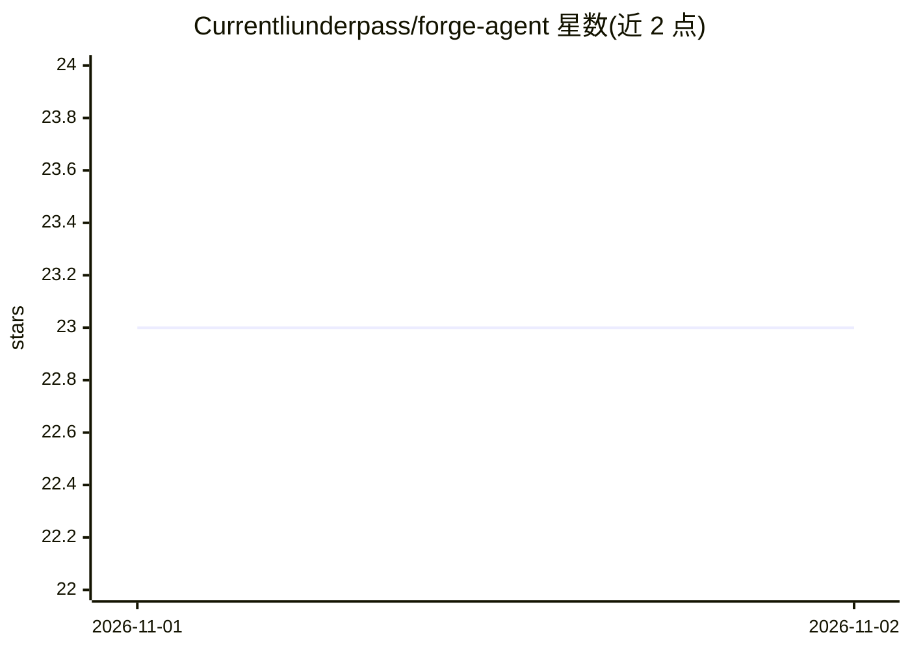

# Currentliunderpass/forge-agent

⭐ 23 · MIT · 推送 2026-10-31 · [GitHub](https://github.com/Currentliunderpass/forge-agent) · 个人维护

**本地优先的开源 AI 编程 agent，支持技能构建与分享**

运行在用户本机的 AI 编程 agent：使用用户自己的 LLM API key，不向云端发送数据。核心机制是 skills——可复用的插件，用于扩展 agent 能力，并可通过社区技能市场安装他人分享的技能。内置 web 搜索、文件读写、shell、HTTP 等工具，采用异步流式输出，提供 CLI 界面。MIT 许可，面向开发者。README 当前未包含安装命令或支持的模型提供商列表。

## 筛选速览

| 维度 | 判定 | 备注 |
|---|---|---|
| AI 角色 | `ai-native` | 本体是模型或模型工具 |
| 许可风险 | `permissive` | MIT |
| 部署形态 | `None` |  |
| 模型依赖 | — | README 未给出锁定关系 |
| 硬件要求 | — | 无带数字的原话,不猜 |
| 安装摩擦 | `low` | 无编译、无系统依赖或容器化 |
| 成熟度 | — | 结构信号不足 |

## 能力要点

- 本地运行，使用用户自有 LLM key，数据不经云端
- skills 可复用插件体系与社区技能市场
- 内置 web 搜索、文件 I/O、shell、HTTP 工具
- CLI 界面，异步流式输出，MIT 开源

## 适用场景

- 在本机运行 AI 编程 agent 处理开发任务
- 构建并复用扩展 agent 能力的技能插件
- 从社区市场安装他人分享的技能

## 场景标签

`编码 Agent` · 领域:编码与开发

## 证据(README 行号)

> L5: Open-source, local-first AI coding agent. Build, share, and install skills. Runs on your machine. Your keys, your da
> L11: Forge is a local-first AI coding agent. It runs on your machine, uses your LLM keys, and never sends data to the cl

## 星数曲线

2026-11-01 23 → 2026-11-02 23（+0）

---
*卡片 v1 · prompt 1.4 · 生成 2026-10-31 · 置信度 mid · 依据 README sha `e5b05a0a33dc` · [字段定义](../../DATASET.md)*
