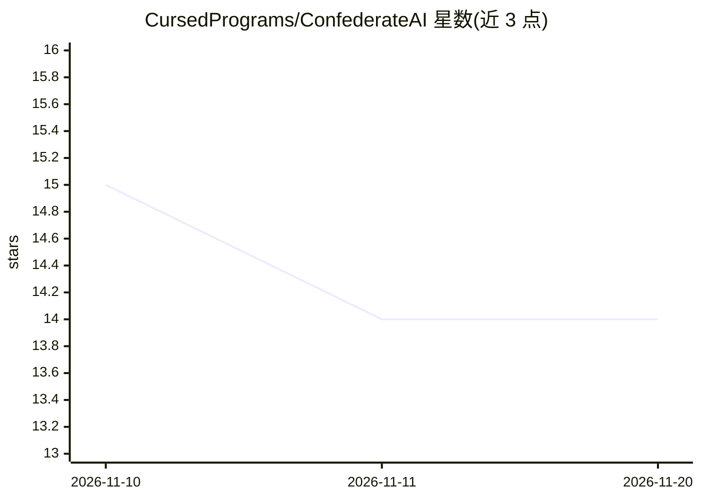

# CursedPrograms/ConfederateAI

⭐ 14 · C# · 推送 2026-11-08 · [GitHub](https://github.com/CursedPrograms/ConfederateAI) · [官网](https://cursedprograms.github.io/ConfederateAI/) · 个人维护

**给 Unity 游戏提供巡逻/战斗/同伴等 NPC 行为的 C# 工具包**

面向 Unity 2022.3 项目的 C# 3D AI 资产：在 NavMesh 上实现同盟与敌对两阵营的相互发现、寻路移动（随机游荡、路径点、带分支的链式路径）、近战（血量/体力/等级/伤害）、布娃娃或动画死亡、同伴跟随、生成器等功能，并附带 Character Editor、Waypoint Manager、AI Creator 等编辑器窗口。README 声明无需第三方插件，要求使用 URP 与新 Input System，需手动挂载多个核心脚本完成场景配置。

## 筛选速览

| 维度 | 判定 | 备注 |
|---|---|---|
| AI 角色 | `ai-native` | 本体是模型或模型工具 |
| 许可风险 | `none` | — |
| 部署形态 | `None` |  |
| 模型依赖 | — | README 未给出锁定关系 |
| 硬件要求 | — | 无带数字的原话,不猜 |
| 安装摩擦 | `low` | 无编译、无系统依赖或容器化 |
| 成熟度 | — | 结构信号不足 |

## 能力要点

- 基于 Unity NavMesh 的纯 C# 实现，README 声明无插件依赖
- 两阵营索敌与近战战斗（血量、体力、等级、伤害）
- 同伴跟随与生成器（可选自动重生）
- 五个编辑器工具（角色编辑/调试/路径点管理/AI 创建/清除）

## 适用场景

- 给 Unity 3D 游戏添加会巡逻和索敌的敌我 NPC
- 配置可跟随玩家的同伴角色
- 用生成器批量创建并管理场景中的 AI 角色

## 场景标签

 · 领域:游戏开发/NPC AI

## 证据(README 行号)

> L16: *Logic-based 3D AI for Unity*
> L21: Allies and enemies that patrol, spot each other, fight, follow you and die in a heap. Plain C# on Unity's NavMesh, 
> L46: The project is a Unity 2022.3 project; open the folder in Unity Hub.

## 星数曲线

2026-11-10 15 → 2026-11-20 14（-1）

---
*卡片 v1 · prompt 1.4 · 生成 2026-11-18 · 置信度 mid · 依据 README sha `c57d544a58df` · [字段定义](../../DATASET.md)*
