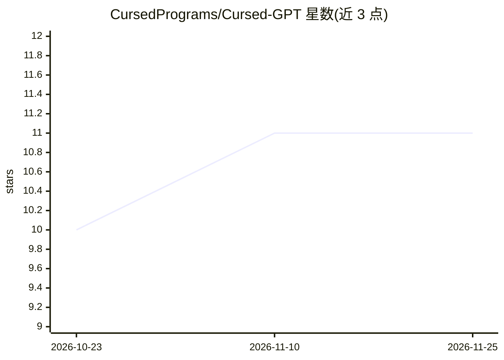

# CursedPrograms/Cursed-GPT

⭐ 11 · Python · MIT · 推送 2026-04-16 · [GitHub](https://github.com/CursedPrograms/Cursed-GPT) · [官网](https://cursedprograms.github.io/cursedgpt-pr/) · 个人维护

**交互式 GPT-2 文本生成脚本，支持终端与 Flask 网页运行**

基于 Hugging Face Transformers 加载预训练 GPT-2 模型，使用 TensorFlow 管理模型、AutoTokenizer 做分词，用户交互输入提示词后生成文本回复。提供终端菜单与 Flask Web 服务器两种运行方式，另有变体脚本支持语音转文字、文字转语音、语音到语音及摄像头功能。安装通过 venv 加 pip 安装 requirements.txt，需自行安装 PyTorch。

## 筛选速览

| 维度 | 判定 | 备注 |
|---|---|---|
| AI 角色 | `ai-native` | 本体是模型或模型工具 |
| 许可风险 | `permissive` | MIT |
| 部署形态 | `library` | 以包/库形式分发 |
| 模型依赖 | — | README 未给出锁定关系 |
| 硬件要求 | — | 无带数字的原话,不猜 |
| 安装摩擦 | `low` | 无编译、无系统依赖或容器化 |
| 成熟度 | — | 结构信号不足 |

## 能力要点

- 交互式输入提示词生成 GPT-2 文本
- 终端与 Flask Web 服务器两种运行方式
- 变体脚本支持语音转文字、文字转语音与摄像头功能
- 提供 install_dependencies.py 安装依赖

## 适用场景

- 在终端或网页上与 GPT-2 对话生成文本
- 搭建带语音输入/输出的本地聊天体验
- 在应用中加入摄像头捕获功能的 GPT-2 交互

## 场景标签

`聊天机器人` `语音合成` · 领域:对话与助手

## 证据(README 行号)

> L28: CursedGPT leverages the Hugging Face Transformers library to interact with a pre-trained GPT-2 model. It employs Te
> L36: - **main.py:** The selection menu for CursedGPT
> L41: - **transformer.py:** Run CursedGPT

## 星数曲线

2026-10-23 10 → 2026-11-25 11（+1）

---
*卡片 v1 · prompt 1.4 · 生成 2026-11-19 · 置信度 high · 依据 README sha `d07e9e20ec10` · [字段定义](../../DATASET.md)*
